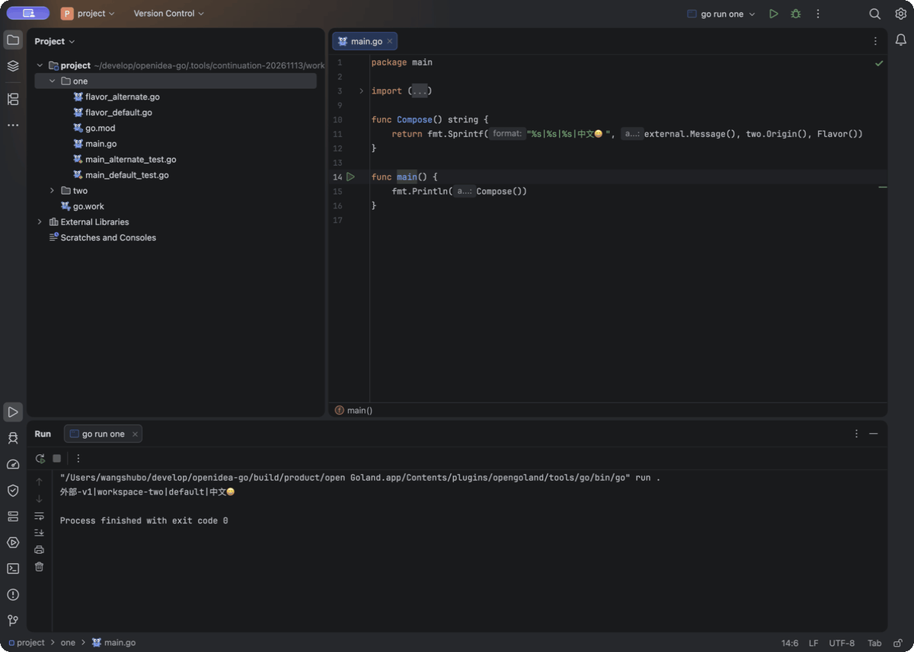
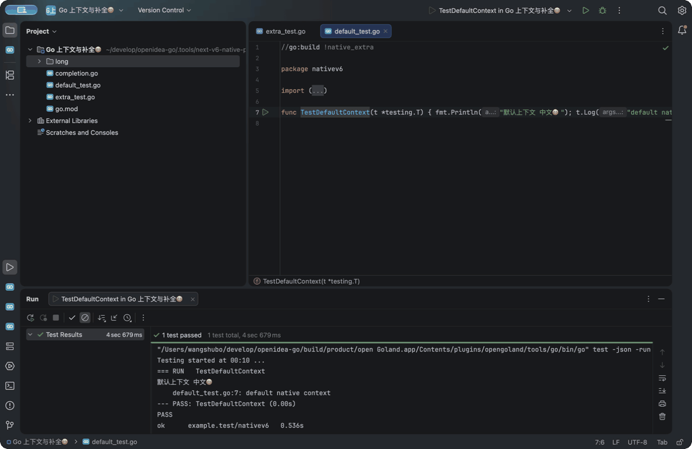
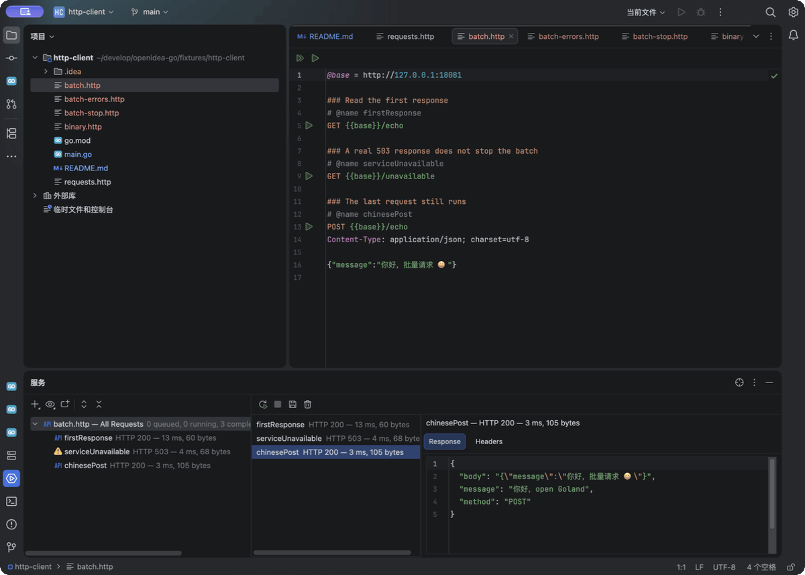

# open Goland

[English](README.md) | [简体中文](README.zh-CN.md)

[Source repository](https://github.com/shubolab/opengoland)

An independent desktop IDE for Go, implemented in Kotlin on the open-source
IntelliJ Platform. The product reference is the locally installed GoLand
2026.1.4. GoLand and PyCharm installations are reference applications, not
components of the generated product.

## See it running



The **0.1.0-preview.20261114.1 macOS arm64 candidate** running in its native
window: run a Go program with Chinese and emoji output, navigate to a newly
named function in a local dependency outside the project, then inspect one
uncached test. Source, test, module and workspace files have distinct icons;
sidebar icons identify their functions.

Three real operation-stage screenshots play for 12 seconds; this is not
continuous video. See the [example source](docs/reference/cold-external-refresh-20261113-evidence/fixture)
and [capture record](docs/demo/native-go-workflow-20261114-recording.json).
Published installer versions are listed below. The [earlier breakpoint and
single-step clip](docs/demo/native-go-workflow.gif) remains available with its
original version and environment in the [demo notes](docs/demo/README.md).



This additional real-window sequence shows build-tag selection, test debugging,
completion with an automatic import, and one Undo. It was captured from the
**pre-release 0.1.0-preview.20261110.6 development candidate on macOS 27.2 arm64**.
The .6 installers have since passed both-platform build checks and are published. The final frame deliberately restores unfinished code. See the
[example and steps](fixtures/native-workflow) and
[capture record](docs/demo/build-context-completion-recording.json).



This additional clip uses the [local HTTP example](fixtures/http-client) in the
**0.1.0-preview.20261113.3 development candidate on macOS**. Three real operation
screenshots show a batch's Chinese JSON response, a variable error with later
requests continuing, and Stop All cancelling the active and queued requests;
the clip is 12 seconds, with idle time compressed. See the
[capture record](docs/demo/http-batch-recording.json) for the exact build.
Published installer versions are listed below.

## Download

Download executable installers from [GitHub Releases](https://github.com/shubolab/opengoland/releases):
`.dmg` for Apple silicon macOS and `.exe` for Windows x64. The distribution
includes its JVM, Go SDK, gopls and Delve. No IDE account, payment or subscription
is required. Git/GitHub/private-repository authentication remains available.
See [installation and platform requirements](docs/installation.md).

[Download preview 0.1.0-preview.20261113.3](https://github.com/shubolab/opengoland/releases/tag/v0.1.0-preview.20261113.3).
Both installers include checksums and platform verification records.

This release adds sequential HTTP batches, named Services results, formatted
JSON and headers, per-item failures with later requests continuing, Stop All,
and original-byte response saving. Earlier repairs for HTTP body boundaries,
supporting-file highlighting, plugin management, Chinese language packs,
terminal/SDK settings and process ownership remain included.

Both published platform builds passed **911 Kotlin tests in 166 reports**, with
zero failures, errors or skips. Each includes 72 HTTP tests, with the response
view and source-navigation regressions passing on both platforms. All eight tests in the Windows process-ownership
package passed, including the actual file-sharing-lock regression. The EXE and
DMG passed their installed-product checks; source inputs, test identities and all
five public asset digests have been independently checked. See the
[.13.3 verification record](docs/verification/releases/0.1.0-preview.20261113.3.json).
Interactive Windows workflows, macOS Developer Mode debugging and full GoLand
parity still require separate acceptance.

| Platform | Direct installer download |
| --- | --- |
| Windows x64 | [Download EXE](https://github.com/shubolab/opengoland/releases/download/v0.1.0-preview.20261113.3/open-Goland-0.1.0-preview.20261113.3-windows-x64-setup.exe) |
| macOS Apple silicon | [Download DMG](https://github.com/shubolab/opengoland/releases/download/v0.1.0-preview.20261113.3/open-Goland-0.1.0-preview.20261113.3-macos-arm64.dmg) |

**Development is active. This repository is not yet a complete GoLand replacement.**
The full target includes the native workbench and editor, Go project/SDK/module
workflows, code intelligence and refactoring, run/test/coverage/benchmark/fuzz,
debugging and goroutines, profiling, terminal, Git, and supporting engineering
tools. Runtime and feature parity remain subject to the acceptance matrix.

## Plugins and Simplified Chinese

**Settings > Plugins** provides native Marketplace search, Installed management,
installation from disk, custom repositories, proxy settings and ordinary plugin
updates. Themes and editor tools use the same general plugin system. Availability
still depends on supported IDE builds, platform APIs and dependencies; this does
not establish compatibility with every JetBrains plugin.

The IDE requires no account or payment. Third-party plugins retain their own
license, payment and account requirements. The bundled Go and LSP integration
components update with the complete open Goland release to preserve required
repairs. Git/GitHub/private-repository authentication remains available.

Use **Help or Tools > 安装简体中文语言包… / Install Chinese Language Pack…** to
obtain the matching official pack, or select a complete matching official IDEA
ZIP you downloaded yourself. After verification, select **localization-zh.zip**
in the native installer and confirm installation. Reopen the IDE, then use
**Enable Chinese and Restart** or select Simplified Chinese under **Settings >
Appearance & Behavior > System Settings > Language and Region** and restart.

The current terminal-enabled candidate repeated this native flow with the
official `com.intellij.zh` 261.26222.65 pack: Installed showed it enabled,
`zh_CN` plus the native Restart action produced a Chinese workbench, and the
ordinary Marketplace still returned current-host-compatible free and Paid
plugin candidates. The official Simplified pack uses its dedicated
official-distribution path because it is shipped with the IDEA distribution.
See the [current native record](docs/verification/plugin-compatibility-current-source-native-20261112.json).

Platform build **261.26222.65** cannot load the old Chinese pack **232.322**, which
supports **232.***. These are IDE platform versions, not Go SDK versions. The
helper preserves native compatibility, dependency and signature checks. It obtains
unmodified resources from JetBrains on the user's request; the repository and
installers do not include those resources. Official source and terms are linked
in the helper. Some independently added Go UI remains English.
See [plugin and Chinese UI verification](docs/verification/plugin-compatibility.md).

The workbench uses Kotlin because the goal is to preserve IntelliJ editor, undo,
test-tree and plugin behavior. These code extension APIs belong to the JVM
ecosystem. A Go-only workbench would also need to recreate those foundations and
provide a compatibility layer for existing plugins. Go remains responsible for
engineering and language-tool services in this architecture.

## Build and launch

Prerequisites for the macOS package: Apple silicon macOS, Python 3.10 or later,
and network access on the first build. The packaging script downloads and
authenticates its Go builder and tools. The project pins Gradle,
LSP4IJ, and the official open-source IntelliJ IDEA 2026.1.4 distribution. The
platform bootstrap verifies the published SHA-256. No global IDE installation
is modified.

Build the independent app, including its own platform, JVM, plugins, and Go
engine and tools:

```sh
./scripts/package-product.sh
./scripts/launch-product.sh "$PWD/fixtures/go-workspace"
```

To produce a mounted and installed-copy checked macOS installer:

```sh
./scripts/package-dmg.sh --version 0.1.0-preview.1 --output build/release
```

Windows installers are built and exercised on Windows by
[the release workflow](.github/workflows/release.yml). Plugin sandbox development
uses `scripts/build.sh` and `scripts/dev.sh` with the pinned builder on `PATH`.

The packaged product uses separate configuration, cache, plugin, and log paths
under `OpenIDEA-Go`. It does not require an installed GoLand or PyCharm.
The preview installers have passed actual build, installation and startup checks;
see the [published verification record](docs/verification/releases/0.1.0-preview.20261113.3.json).
Signing, notarization and full GoLand feature parity remain open.

The display name is `open Goland`, the Gradle project and CLI are `opengoland`,
and the macOS bundle ID is `dev.opengoland.ide`. Existing internal plugin IDs and
the isolated `OpenIDEA-Go` settings directory are retained for configuration
compatibility. The local checkout directory does not affect the product name.

The installers include Go 1.26.10, gopls 0.24.0 and a patched source build of
Delve 1.27.2. Settings > Go shares the native SDK selector with New Project:
use the bundled SDK, choose **Add local…** for a local Go home, or choose
**Download…** for a current stable official SDK. Explicit SDK and
tool executable selections take precedence.
The release builder uses Go 1.27.3 separately from the bundled project SDK.

Welcome > New Project and File > New > New Project open the native Go wizard
with name/location, module path, SDK, environment and optional example/tests.
The verified SDK and environment are saved with the project. Settings > Go
selects SDKs, tool executables and project build environment. Tools > Go contains
module/workspace and engineering actions. File > New > Go Module opens the same
Go creation flow. Go Build, Go Test, and Go
Debug configurations use the platform's native execution and debugger UI.

New local Terminal sessions use the project-selected Go SDK. The selected Go
bin directory and project `GOROOT`, build tags, target OS/architecture, CGO and
configured environment are applied after the user's zsh, bash, fish or
PowerShell startup files run, while the shell's own PATH and variables remain
available. The terminal starts in the project directory. Terminating a running
terminal closes the shell and its foreground child process.

Current source adds native Go Template, SQL, Dockerfile and HTTP request
highlighting. In `.http` files, run one request or use **Run All Requests** for
sequential execution. Native Services shows named results, formatted JSON and
headers; **Stop All** cancels the batch and **Save Response…** saves original
response bytes. Try the [local HTTP example](fixtures/http-client).
Batch, Services and response saving are included in the published `.13.3`
installers above.
HTTP environment files, scripts and credential management,
database connections, Docker execution and template semantics remain open.
See [HTTP syntax and limits](docs/verification/http-client.md).

[Native type search](docs/verification/type-search.md) supplies the standard
Go To Type / Search Everywhere Types catalog, including selected SDK and
dependency declarations. [Extract and Inline](docs/verification/native-refactor.md)
use typed plans, native naming and preview, and global Undo/Redo.
[Debug test results](docs/verification/debug-test-trees.md) connect both test
configuration entries to the native test tree and failed-test retry. Each record
states its supported cases and remaining boundaries.
The [fresh standalone checks](docs/verification/native-workflows.md) cover cold
type search, SDK navigation, custom method extraction, two-file Inline All with
Undo/Redo, both test-debug entries, failed-only retry and Stop cleanup. The newer [native entry work](docs/verification/native-entry-fidelity.md) adds the
Go-primary Types title, guarded catalog reuse, synchronized usage highlighting
and the standard global failed-test action. Each record retains its exact
build and native verification boundaries; cold catalog performance remains open.

Run > Edit Configurations > **+** also provides these attach configurations:

- **Go Attach to Process**: enter the PID of an existing local Go process and
  the local adapter working directory, then Debug the configuration. The selected
  Delve executable starts a local DAP adapter. Attaching does not rebuild the
  target or change its environment; build the target with debug symbols, for
  example `go build -gcflags='all=-N -l'`, when needed. Stop requests a
  non-terminating detach and closes the local adapter. A native check found
  that stopping while paused could leave the surviving target OS-stopped;
  resume before Stop when the process should keep running. The current handler
  now waits for non-terminating detach before adapter cleanup, and one packaged
  entry-paused Stop check restored the target heartbeat. The historical
  intermittency remains open; see [Stop ordering evidence](docs/verification/debug-stop-ordering.md).
- **Go Remote Debug (DAP)**: enter the DAP host and TCP port reachable from the
  IDE, including through an existing tunnel. Select the server type explicitly.
  For **dlv dap — attach to process ID on server**, start an external
  `dlv dap --listen=127.0.0.1:38697` and enter the PID on that server's machine.
  Stop detaches from the target; the single-use external adapter normally exits.
  For **Headless Delve — existing session (DAP)**, the server already owns the
  debugging session, so no PID is entered in the IDE. Start that server with
  `--accept-multiclient`, for example:

  ```sh
  dlv --headless --accept-multiclient --listen=127.0.0.1:38697 exec ./server
  ```

  Stop disconnects from a multi-client headless server and preserves the target's
  current running or paused state. Resume before Stop if the target should keep
  running. A single-client headless server can terminate a target it launched,
  even when the client requests a non-terminating disconnect. These connections
  use DAP; generic JSON-RPC endpoints are unsupported.

On macOS, the host must allow the system debugger to attach processes. open
Goland checks this before starting Delve. If it reports that debugger attach
permission is disabled, run `sudo DevToolsSecurity -enable` in Terminal, enter
the administrator password there, and rerun Debug. The IDE never asks for or
stores that password. Managed computers may require their administrator to
allow developer tools. Without this permission, Delve starts the LLDB helper and
waits at the launch step because macOS has blocked the attach, so change this
system setting before diagnosing the Go test itself.

Both configurations accept source mappings in the direction **local IDE prefix
=> remote server prefix**, one per line, for example
`/Users/me/project => /srv/project`. The mapping translates local breakpoint
paths to server paths and returned stack locations back to local sources.
The native debugger uses DAP threads for Go goroutines and evaluates Watches in
the selected stack frame. The three attach protocol scenarios have passed the
direct-tool probe below. Native local PID attach, goroutine/frame selection,
evaluation, and Stop leaving the target alive have also been exercised. Remote
`dlv dap` configuration UI, mapped stack/breakpoint navigation and running-target
detach have since passed a native loopback check. Native headless configuration,
mapped frame navigation, Unicode Watch evaluation, and preservation of a paused
multi-client session also passed on loopback; native headless breakpoint
interaction remains open. A later packaged native check also verified local
Variables recovery, Unicode Watch editing, field modification and stepping;
see [native debug recovery](docs/verification/native-debug-recovery.md) for exact
build evidence and the remaining immediate-value-refresh, entry-frame value-edit,
and paused-Stop limitations. The `3331c4e` package passed a native wire/heartbeat
check for removing a file's last breakpoint while another file retains one.
The newer semantic-token bridge partitions large Go files into bounded requests;
real gopls integration and native SDK `runtime/proc.go` display checks have passed.
See the [large-file evidence](docs/verification/large-file-semantic-tokens.md)
for the exact snapshots and remaining native cancellation checks.

Preview `.5` retains the standard Pause and first-load source-navigation repairs,
and repairs the reproduced Apple silicon syscall caller-variable case and Go
Test pre-connect Stop handling. Test debugging also prepares and probes
`test2json` with the selected SDK before opening the debug session. Native
external-SDK directory selection, verification, Apply, restart persistence,
real test execution and restoration have been exercised in the current macOS
candidate; the preparation task's visible Cancel control still needs complete
desktop verification. See the
[candidate native checks](docs/verification/derived-delve-candidate-native.json),
[preparation task checks](docs/verification/go-test-preparation-task.json), and
[local SDK workflow](docs/reference/sdk-local-chooser-native-20261112.json),
[public installed-copy record](docs/verification/debug-session-public-v5-native.json)
for their separate scopes; these passes do not close every debugger race.

The public `.5` native check recorded a warning from a pause notification
arriving after the debugger had stopped. The test and target processes
terminated correctly; this warning remains unresolved in this release.

Code > Optimize Imports uses gopls through the standard native action. Standard
Rename opens a cross-file Diff preview; approved edits use a single global
Undo/Redo command. Refactor > Change Signature provides native parameter/result
tables and a typed Go engine planner for name, parameter, result, call and
interface changes, including explicit defaults and migrations. It preserves
evaluation order and previews the complete file/usage group before applying.
Native cross-module, interface, added-parameter/result and Undo/Redo checks have
passed; [implementation and boundaries](docs/verification/change-signature-implementation.md)
describe conservative conflicts, UI gaps and build-context limitations.
Refactor > Go Refactor also offers gopls refactorings for the selection.

Code > Generate provides Empty test file, Test for function, Tests for file, and
Tests for package. The native dialog selects declarations, same/external package,
test names, and concrete generic types. A typed Go planner validates the full
candidate before a cross-file Diff preview; applying uses one global Undo/Redo
command. Standard Test/Subject navigation is integrated. See the
[test-generation evidence and boundaries](docs/verification/test-generation.md).

Code > Implement Methods and the native **Implement interface** inlay open a typed
receiver/interface chooser. It supports existing local types or a new struct,
pointer/value receivers, generic interfaces, and all or selected missing methods.
The complete candidate is checked before Diff preview and grouped Undo/Redo.
Local aliases and test-package mocks are supported. See the
[interface-generation evidence and boundaries](docs/verification/interface-generation.md).

Code > Generate > Struct Tags and **Edit struct tags** under Alt+Enter provide
field selection, custom tag keys, naming styles, and add/update/remove operations.
Other keys, explicit ignore values, and existing options are retained by default.
The typed planner previews a complete candidate before one global Undo/Redo
transaction. This bulk editor is an independent workflow; GoLand's documented
multi-caret tag-value editing remains a separate parity item. See the
[struct tag evidence and boundaries](docs/verification/struct-tags.md).

Code > Generate also offers native **Constructor**, **Getter**, **Setter**, and
**Getter and Setter** dialogs for named structs, with field selection, editable
names, generic types, pointer/value choices, typed validation and global Undo.
Alt+Enter on a field defaults to that field. **Edit tag values for key** adds
native value-start carets for simultaneous input. See the
[struct helper evidence](docs/verification/struct-helpers.md) and
[multi-caret boundaries](docs/verification/struct-tag-carets.md).

Code > Generate > **Type from JSON** opens a native JSON editor with a type
name and numeric policy. **Struct Fields from JSON** and the struct intention
add selected new fields while retaining existing fields and tags. Analyze /
Refresh shows inferred fields, nested types and warnings; Preview opens the
validated native Diff before Apply. Edits to the input invalidate the analysis.
See [JSON generation and inference boundaries](docs/verification/json-generation.md).

Workspace edits check actual document versions and unsaved changes,
with a separate verified-disk baseline for closed files. Consult the
[transaction boundaries](docs/verification/workspace-edit-architecture.md)
for unsupported resource-edit cases and checks still awaiting native evidence.

The native Go Test configuration has `gotest`, `gobench`, and `go test -fuzz`
frameworks. Benchmark settings include exact patterns, duration/iteration limits,
and allocation reporting. Fuzz settings include a function pattern, time/iteration
limit, minimization limit, and worker count. Empty ordinary-test patterns exclude
unrelated tests in Benchmark/Fuzz modes. Fuzz Debug executes seed corpus without
mutation workers. Saved failing inputs open from console links as corpus data;
supported filenames offer exact seed Run/Debug. See the
[test workflow evidence and boundaries](docs/verification/native-test-workflows.md).

Go Test also supports the native Run with Coverage executor. Go Coverage shows
statement totals and editor markers. Go Profiles generates CPU/memory/block/mutex
pprof files, displays flat/cumulative hotspots, and opens recorded source locations.
Go Inspections runs Vet or golangci-lint across one module or the workspace, with
clickable diagnostics. Configure the optional golangci-lint executable under
Settings > Go > Go Inspections.

## Verification and evidence

```sh
./scripts/build.sh
(cd engine && go test -race ./... && go vet ./...)
python3 scripts/verify-go-tools.py
python3 scripts/verify-go-attach.py
```

The direct-tool probe uses disposable copies of the fixture and exercises real
gopls and Delve. Its success establishes the tools' protocol behavior, not the
desktop integration. A separate native smoke has verified plugin loading,
cross-module definition navigation, program execution, passing subtest trees,
completion candidate insertion, and a breakpoint/variables/evaluation/step/resume
workflow. Later snapshots have native coverage, profiling, inspections, immediate
long-test progress, import cleanup, and cross-module rename with one-step
Undo/Redo evidence. Each observation is tied to its actual source snapshot;
these checks do not establish full product equivalence.

The historical 395-input native-workflows build passed all 524 Kotlin/platform tests across 108
reports, with zero failures, errors or skips. The uncached Go race command passed
329 test events, including 192 top-level tests, across 11 test packages; Go vet
passed. Its 395 frozen inputs and two earlier failed build attempts are recorded
separately in the [native-workflows build record](docs/verification/native-workflows-build.json).
It includes typed test/interface/struct-helper/tag/JSON generation, native tag carets,
Unicode project-path persistence, dirty-source and two-file native
Undo/Redo, stale dependency rejection, named Test/Subject chooser navigation,
clickable interface inlays, immutable settings/connection ownership, and actual
upstream LSP initialization/deletion/UTF-16 synchronization regressions. Native evidence includes
an unsaved go.work adding an unopened external caller, stale-preview rejection,
three-file interface migration, and combined name/parameter/result conversion.
The [native records](docs/verification/change-signature-native.json) retain
fixture sources, outputs and the actual build identities.

The current [JSON generation cohort](docs/verification/json-generation-native.json)
also passed two uncached Go round-trip tests through the standalone IDE.
A separate [native multi-caret trace](docs/verification/multicaret-gopls.md)
records actual gopls hover and versioned error/Undo/Redo results, including the
normal production scheduling path and its remaining coverage limits.

The latest [module/workspace task checks](docs/verification/module-task-scopes.md)
cover explicit module targets, workspace download/vendor/sync, sequential generation,
and native Stop with owned-process cleanup. [New Go module creation](docs/verification/sdk-project-creation.md)
rejects a non-Go executable and creates a real SDK-validated project that passes
native Run/Test. [Find Usages](docs/verification/find-usages.md) now filters the
requested scope and retains cross-file references; real two-module navigation and
Current File filtering were observed. The native toolbar's hover-popup interaction
remains open. A later [Find Usages policy check](docs/verification/find-usages-policy.md)
removes unrelated type-definition/implementation queries while retaining real
reference errors and explicit LSP navigation. Standard platform implementation
and type-declaration actions did not dispatch queries in that older desktop check.
The later [standard navigation repair](docs/verification/standard-navigation.md)
connects the real platform actions, native multi-target choosers and Type
Declaration. The final standalone package passed Unicode and selected-SDK
navigation, unsaved target-only movement, third-file semantic changes, and
Undo/Redo queries with fresh actual gopls requests. It also passed a native Go
test and exact-label Go Settings search. The subsequent
[hierarchy and Structure repair](docs/verification/hierarchy-structure.md)
passes native type/call trees, Base On actions, unsaved target movement,
recursive-call termination, and function/type signatures in Structure and File
Structure. It also closes the four navigation getters' concurrent parameter-gate
regression in actual-SDK tests. The later [package Structure batch](docs/verification/structure-package.md)
adds receiver grouping across files, package/current-file views, private-member
filtering and exportability sorting. Its repaired standalone package passes native
method preselection, cross-file navigation, unsaved closed-buffer/Undo handling
and two uncached Go tests including CGO. Complete hierarchy scope semantics,
all Structure options and full navigation parity remain open.
[Build identities and cohort boundaries](docs/verification/module-usages-build.json)
keep these checks separate from earlier delivery evidence and full IDE acceptance.

The [native Go typing batch](docs/verification/editor-typing.md) adds quote
pairing/overtyping, comment continuation, Go Enter/closing/case indentation and
the raw-string indentation preference. Real standalone keyboard actions,
Undo/Redo and two uncached Go tests were observed in a Unicode-path workspace.
The [typing build record](docs/verification/editor-typing-build.json) identifies
the exact 332-input package; lexer/PSI, IME, full performance and commercial
runtime equivalence remain bounded as documented.

The attach probe starts only its own temporary fixtures and adapters. It verifies
local PID attach, external `dlv dap` PID attach, and headless multi-client DAP
attach, including source mapping, goroutines, Watches, target survival after
detach, and cleanup of its owned processes. Native local configuration/Stop
evidence is recorded separately from the direct protocol results.

- [Reference investigation](docs/reference/README.md): exact local versions,
  selected resource declarations, file/member digests, and evidence limitations.
- [REA evidence ledger](docs/reference/rea-ledger.md): retained shipped-artifact
  identities and native observation limitations.
- [Product acceptance matrix](docs/reference/acceptance-matrix.json): full target
  requirements and verification state. A declaration or compile result cannot
  satisfy a runtime requirement.
- [Direct Go tool verification](docs/verification/go-tools.json).
- [Direct DAP attach verification](docs/verification/go-attach.json).
- [Native desktop observations](docs/verification/desktop-smoke-2026-11-08.md).
- [Native debug recovery](docs/verification/native-debug-recovery.md): attached
  Variables, Unicode Watches, field modification, stepping, external DAP source
  mapping and detach, and remaining limits.
- [Native test/benchmark/fuzz workflows](docs/verification/native-test-workflows.md).
- [Native test generation](docs/verification/test-generation.md).
- [Native interface-method generation](docs/verification/interface-generation.md).
- [Deletion lifecycle controls](docs/verification/lsp-deletion-lifecycle.json).
- [Initialization document synchronization](docs/verification/lsp-document-sync.md).
- [Standard navigation, cache invalidation and Settings search](docs/verification/standard-navigation.md).
- [Hierarchy, Structure signatures and concurrent navigation parameters](docs/verification/hierarchy-structure.md).
- [Package Structure, receiver groups, native filters and popup selection](docs/verification/structure-package.md).
- [Attach Stop ordering](docs/verification/debug-stop-ordering.md).
- [Engine protocol and tests](engine/README.md).
- [Pinned platform input](product/platform.lock.json).

The open-source platform provides the workbench/editor foundation. LSP4IJ
provides open-source LSP/DAP integration, gopls Go language analysis, and Delve
debugging. GoLand-specific semantic and engineering behavior must be reproduced
and verified independently. The product retains upstream notices and does not
include the proprietary GoLand Go plugin.

The packaged OSS platform includes a pinned public-source fix for supplementary
Unicode in persisted map keys. An emoji project path now survives trust/recent
project serialization and a normal restart. This preserves explicit trust
decisions; it does not infer or migrate historical truncated paths. See the
[Unicode persistence evidence](docs/verification/unicode-persistence.md).
