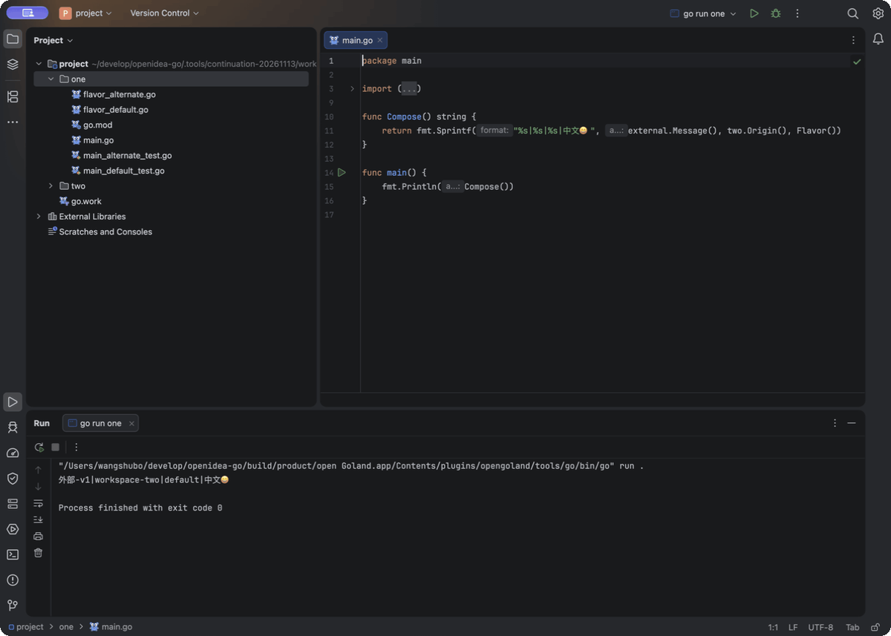
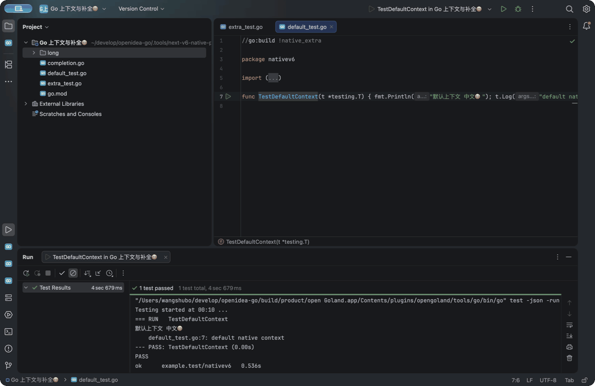
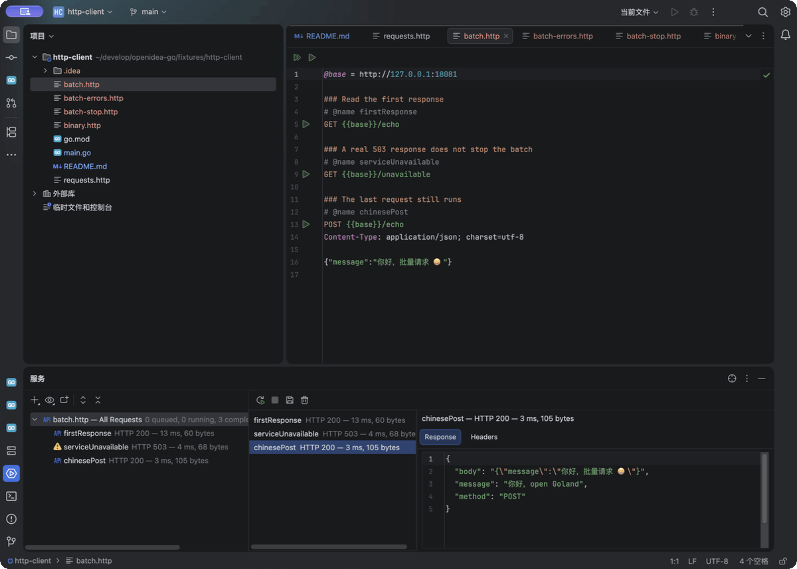

# open Goland

[English](README.md) | [简体中文](README.zh-CN.md)

**一个正在开发的独立 Go 桌面 IDE。** 有原生的项目窗口、代码编辑器、运行与测试面板、调试器、终端和 Git 工具，目标是逐步对齐 GoLand 的完整日常工作流程。

界面和编辑器建立在开源 IntelliJ Platform 上，由 Kotlin 接入 Go 功能；Go 引擎、gopls 和 Delve 负责代码分析、工程任务与调试。GoLand 2026.1.4 是功能和交互的参考，商业 GoLand 插件不包含在本产品中。

适合希望使用原生桌面界面开发 Go、并愿意体验预览版本的开发者。**目前还不能当作完整的 GoLand 替代品**；下面列出的功能有各自的验证范围，完整验收仍在进行。

## 运行起来是什么样



这是 **0.1.0-preview.20261114.2 候选版在 macOS（Apple silicon）上的真实界面**：运行含中文和 emoji 的 Go 程序 → 在终端执行 Go 命令 → 在 IDE 测试面板查看一次不使用结果缓存的测试。源码、测试、模块和工作区文件各有对应图标，侧栏也按功能区分。

动图由三个真实操作阶段的窗口截图组成，共 12 秒，不是连续录屏。[示例源码](docs/reference/cold-external-refresh-20261113-evidence/fixture)与[录制记录](docs/demo/native-go-workflow-20261114-2-startup-fixed-recording.json)保留了实际来源和范围；公开安装包以下方下载区为准。[较早的外部依赖与跳转演示](docs/demo/native-go-workflow-20261114-2.gif)及[历史断点与单步演示](docs/demo/native-go-workflow.gif)保留各自的源码、版本和验证边界，见[演示说明](docs/demo/README.md)。



这个补充片段展示切换构建标签后的测试、补全时自动导入，以及一次撤销。录于 **0.1.0-preview.20261110.6 构建前的开发候选版，macOS 27.2 arm64**，由真实操作截图制作；末帧有意撤回到尚未写完的代码。对应的 .6 安装包现已通过双平台构建并发布，[示例与复现步骤](fixtures/native-workflow)和[录制记录](docs/demo/build-context-completion-recording.json)保留了具体范围。



这个补充片段来自 macOS 上的 **0.1.0-preview.20261113.3 开发候选**，使用仓库中的
[本地 HTTP 示例](fixtures/http-client)，展示批量请求的中文响应、单项变量错误后继续，
以及 Stop All 取消当前和排队请求。它由三张实际操作阶段截图组成，共 12 秒；
[录制记录](docs/demo/http-batch-recording.json)
保留了具体构建与验证边界。公开安装包版本见下方下载区。

## 下载与安装

当前公开版本是 [0.1.0-preview.20261114.2](https://github.com/shubolab/opengoland/releases/tag/v0.1.0-preview.20261114.2)。请下载安装程序，GitHub 自动生成的 Source code 压缩包不能直接安装。

| 系统 | 直接下载 | 安装方法 |
| --- | --- | --- |
| Windows x64 | [下载 EXE 安装器](https://github.com/shubolab/opengoland/releases/download/v0.1.0-preview.20261114.2/open-Goland-0.1.0-preview.20261114.2-windows-x64-setup.exe) | 运行安装向导，从开始菜单启动 |
| macOS，Apple silicon（M 系列芯片） | [下载 DMG 镜像](https://github.com/shubolab/opengoland/releases/download/v0.1.0-preview.20261114.2/open-Goland-0.1.0-preview.20261114.2-macos-arm64.dmg) | 打开镜像，将 `open Goland.app` 拖到 Applications，再打开应用 |

安装包自带 JVM（运行 IDE 所需的 Java 环境）、**Go 1.26.10、gopls 0.24.0，以及基于 Delve 1.27.2 的补丁构建**。基本的 Go 编辑、构建与测试无需另装 Java、Go 或语言服务工具；也可以选择自己安装的 Go SDK。

每个发布版本提供 `.exe`、`.dmg`、[SHA256SUMS 校验文件](https://github.com/shubolab/opengoland/releases/download/v0.1.0-preview.20261114.2/SHA256SUMS)，以及 macOS、Windows 两份构建与安装验证记录。已公开版本的安装包不会原地替换，后续修改使用新版本号。

本版把重复的蓝底 GO 图标换成透明底的 Go 小地鼠（Gopher），测试文件使用红绿角标，模块/工作区文件各有标记，侧栏按功能区分。已打开 Go 包实际使用的本地 `replace` 依赖中，现有文件变化会更新诊断、补全与跳转；零参数提示也已修正。修正 Windows 安装后启动初始化，工程信息查询结束或取消时只回收本次启动的工具进程。此前 `.14.1` Windows 候选失败未发布，[原始失败记录](docs/verification/windows-build-context-process-20261114/REPORT.zh-CN.md)继续保留。已有 HTTP、插件与中文界面、终端/SDK 功能继续包含。

两平台各 **969 个 Kotlin 测试、174 份报告全部通过**，没有失败、错误或跳过；实际 EXE、DMG 的安装检查成功，五个公开资产的摘要、源码清单及原始测试条目通过了私有草稿和公开发布后的独立核对。本机演示来自同一份源码，云端安装包另有各自的安装验证记录。具体结果见[.14.2 发布验证记录](docs/verification/releases/0.1.0-preview.20261114.2.json)。

Windows 交互式终端、插件与中文界面，以及 macOS Developer Mode 调试闭环仍需原生验收；完整 GoLand 对齐仍在进行。

IDE 本身无需账号，没有计费、订阅或付费功能门槛。Git、GitHub、私有仓库和项目依赖所需的认证仍然保留，使用这些服务时需要它们各自的凭据。

当前 Windows 安装器未使用发行者证书签名；macOS 应用采用临时签名，尚未公证。系统可能要求你确认是否打开。具体要求见[安装说明](docs/installation.md)。当前发布的安装器覆盖 Windows x64 和 macOS arm64；没有在这里承诺 Linux 或 Intel Mac 安装包。

## 第一次使用

1. **新建项目**：欢迎页选择 **New Project**，或使用 **File > New > New Project**。填写项目名称、保存位置和 module path；module path 就是 Go 在 `go.mod` 中使用的模块名称，例如 `example.org/hello`。
2. **选择 Go SDK**：默认使用内置版本。新建项目和 **Settings > Go** 共用 SDK 选择器，可以通过 **Add local…（添加本地 SDK）** 选择已安装的 Go 主目录，或通过 **Download…（下载）** 下载官方稳定版本。
3. **按需填写环境变量**：例如代理、构建开关或项目所需的变量。向导中的 SDK 与环境设置会随项目保存。可以勾选示例代码与测试，创建后直接运行。
4. **打开已有项目**：选择 **Open**；从远程仓库开始则选择 **Clone Repository**。多模块项目可使用 Go 自己的 `go.work` 工作区。
5. **运行与测试**：使用代码旁的运行入口，或在 **Run > Edit Configurations** 中建立 Go Build、Go Test、Go Debug 配置。执行结果显示在原生 Run、Test、Debug 面板中。

新建本地 **Terminal** 会使用当前项目选择的 Go SDK。即使你的 zsh、bash、fish 或 PowerShell 启动脚本重新设置了 `PATH`/`GOROOT`，IDE 也会在用户配置加载完成后恢复项目 SDK，并保留原有 shell 的 PATH 和自定义变量。终端仍从项目目录启动；关闭正在运行的终端并确认 Terminate 后，shell 及其前台子进程会一起结束。

SDK 下载会核对官方目录中的大小与 SHA-256，再验证解包后的 Go 版本和主目录；目标必须是新目录，已有 SDK 不会被覆盖。取消或验证失败不会登记为已安装 SDK。下载需要联网，项目依赖也可能需要访问网络。

外部 SDK 的 **Add local…** 已经在当前 macOS 候选包中完成原生目录选择、版本校验、Apply、重启后保留、实际 Go 测试以及恢复内置 SDK 的完整流程；长路径把下拉箭头挤出窗口的问题也已修复。测试调试准备过程的原生 Cancel 按钮仍需单独验收，不能把 SDK 选择通过等同于所有调试步骤通过。[本机 SDK 流程记录](docs/reference/sdk-local-chooser-native-20261112.json)与[SDK 与新建项目验证](docs/verification/sdk-project-management-public-native.json)分别覆盖不同范围。

### macOS 调试提示

macOS 可能禁止 Delve 调用系统调试器附加进程。open Goland 会在启动 Delve 前检查这一权限；如果看到“macOS has not enabled debugger attach permission”，请在终端执行：

```sh
sudo DevToolsSecurity -enable
```

随后输入本机管理员密码并重新执行 Debug。IDE 不会收集密码，也不会尝试绕过公司的设备管理策略；受管理电脑需要由管理员开放开发者工具权限。未开放时，Delve 会启动系统调试辅助进程后停住，不能把它误判为测试代码卡住。

## 插件与简体中文

在 **Settings > Plugins** 中，可以从原生 **Marketplace** 搜索插件，在 **Installed** 管理已安装插件，也可以从磁盘安装或配置自己的插件仓库和代理。主题、编辑辅助等普通插件都可以使用这些入口；能否运行仍取决于插件支持的 IDE 版本、平台接口和依赖。恢复市场不等于所有 JetBrains 插件都兼容。

IDE 本身无需账号或付费；第三方插件保留自己的许可、收费和账号规则。随 IDE 提供的 Go 与 LSP 集成组件由整个 open Goland 版本统一更新，避免普通插件更新覆盖本产品所需的修复。Git、GitHub 和私有仓库认证仍然保留。

想使用简体中文，打开 **Help（帮助）或 Tools（工具）> 安装简体中文语言包… / Install Chinese Language Pack…**，也可以通过 **Find Action** 搜索这个名称：

1. 选择“从 JetBrains 官方获取（约 3.6 MB）”，或选择自己下载的匹配版本完整官方 IDEA ZIP。
2. 等待校验完成，在打开的原生文件窗口中选中 **localization-zh.zip**，确认安装。
3. 按提示重新打开 IDE。看到 **Enable Chinese and Restart** 时可以直接启用；也可以到 **Settings > Appearance & Behavior > System Settings > Language and Region** 选择简体中文，再按提示重启。

当前终端候选包已再次通过同一原生流程：从 JetBrains 官方取得并安装 `com.intellij.zh` 261.26222.65，Installed 显示已启用；选择 `zh_CN` 后通过原生 Restart 重启，菜单、项目树、设置和搜索界面均显示简体中文。普通兼容插件仍通过原生 Marketplace 搜索和安装；中文包使用专用官方分发入口，因为它是 IDEA 发行包的一部分。验证记录见[当前源码原生记录](docs/verification/plugin-compatibility-current-source-native-20261112.json)。

当前 IDE 平台版本是 **261.26222.65**。旧语言包 **232.322** 支持的是 **232.***，两者不兼容；这些是 IDE 平台版本号，不是 Go 语言版本。上面的入口会取得匹配的包，并保留原生版本、依赖和签名检查。

中文资源由用户主动从 JetBrains 官方获取，不附带在本仓库或安装器中；入口保留官方来源和条款链接。它主要翻译平台界面，部分本项目新增的 Go 界面仍为英文。验证范围见[插件与中文说明](docs/verification/plugin-compatibility.md)。

## 现在有哪些功能

下面是已实现的主要入口。这里的“已实现”不表示覆盖所有 Go 语法、构建环境和 GoLand 行为；链接中的记录保留了具体支持范围与已知问题。

| 工作 | 已有能力与常用入口 |
| --- | --- |
| 写代码 | 原生编辑器、语法着色、补全、诊断、引号配对、注释续行、Enter 缩进与 Undo/Redo；代码分析接入 gopls |
| 找代码 | 标准定义、类型声明、实现与 Find Usages；Go To Type / Search Everywhere 的类型搜索；类型与调用层次、Structure 文件/包结构树 |
| 改代码 | Rename、Change Signature、Extract、Inline；支持的变更先显示跨文件差异预览，再作为一组应用并支持撤销 |
| 生成代码 | 测试文件/函数/文件级/包级测试、接口实现、构造函数、getter/setter、struct tag 编辑、从 JSON 生成类型或字段 |
| 跑项目 | Go Build、Go Test、Go Debug 原生配置；选择 SDK、环境变量与工作目录；输出和停止入口接入原生面板 |
| 做测试 | 测试树、子测试、失败重跑、benchmark、fuzz 与失败输入重放；支持测试调试和覆盖率 |
| 查性能与质量 | CPU/内存/block/mutex 的 pprof 结果视图、热点源码跳转、Go Vet 与可选的 golangci-lint 诊断 |
| 管工程 | `go.mod` / `go.work` 相关的 tidy、download、vendor、workspace sync、generate 等任务；原生终端和 Git 工具 |

当前源码还提供 Go Template、SQL、Dockerfile 和 HTTP 请求文件的原生高亮。
`.http` 可以运行当前请求，或用 **Run All Requests** 按顺序执行整个文件，在原生
Services 面板按名称查看响应、格式化 JSON 和响应头；**Stop All** 取消整批，
**Save Response…** 保存原始响应字节。可直接试用[本地 HTTP 示例](fixtures/http-client)。
批量、Services 和保存功能已包含在上方 `.13.3` 安装包中。HTTP 环境文件、脚本、凭据管理，
以及数据库连接、Docker 执行和模板语义分析仍未实现，见[支持范围](docs/verification/http-client.md)。

### 导航与重构

类型搜索能查找项目、所选 SDK 和依赖中的类型，包含泛型别名、命名函数类型等声明。Structure 可以按接收者类型组织方法，切换当前文件/包范围，过滤私有成员并排序。

重构并非简单文本替换。支持的操作会结合 Go 类型信息、当前未保存内容和构建环境制定变更计划；应用前复核相关文件，冲突时拒绝继续。跨文件修改使用原生 Diff 预览和一组 Undo/Redo。并非任意语法和工程都能自动改写，Extract/Inline 等操作遇到不支持的情况会给出冲突。

- [标准导航与缓存边界](docs/verification/standard-navigation.md)
- [包结构与接收者分组](docs/verification/structure-package.md)
- [类型搜索](docs/verification/type-search.md)
- [Change Signature](docs/verification/change-signature-implementation.md)、[Extract / Inline](docs/verification/native-refactor.md)

### 代码生成

**Code > Generate** 提供测试、构造函数、getter/setter、Struct Tags、Type from JSON 等入口；**Code > Implement Methods** 与接口实现提示可以选择类型、接口和缺失方法。生成前可以调整名称、字段、泛型实参等选项。

JSON 生成是根据样本推断类型，不把样本当作完整的数据格式约束；`null`、缺失字段和混合数组等情况会显示推断结果或警告。生成的测试骨架仍需要补充断言，接口方法占位体仍需要实现业务逻辑。

- [测试生成](docs/verification/test-generation.md)、[接口实现](docs/verification/interface-generation.md)
- [Struct tag 编辑](docs/verification/struct-tags.md)、[构造函数与 getter/setter](docs/verification/struct-helpers.md)
- [JSON 推断与生成](docs/verification/json-generation.md)

### 测试、调试与工程工具

Go Test 配置支持普通测试、benchmark 和 fuzz。测试树可展示进度、子测试和失败结果；调试测试、失败重跑、覆盖率、失败输入链接都有独立验证记录。fuzz 的 Debug 用于重放种子，不启动随机变异 worker。

调试器支持断点、调用栈、变量、表达式求值、Watches、步进与继续，也提供 **Go Attach to Process** 和 **Go Remote Debug (DAP)**。远程调试需要对应的 Delve DAP 服务；源码映射按“本机路径 → 服务端路径”填写。它不是任意远程端口都可连接的通用调试器。

附加到已有进程时，Stop 请求非终止式分离，但仍有暂停状态下分离的已知边界。若希望目标继续运行，应先 Resume 再 Stop。外部单客户端 headless Delve 的生命周期也可能导致其启动的目标被终止，应先阅读[附加与 Stop 说明](docs/verification/debug-stop-ordering.md)。

- [测试、benchmark 与 fuzz](docs/verification/native-test-workflows.md)、[调试测试树与失败重跑](docs/verification/debug-test-trees.md)
- [调试器已验证行为与限制](docs/verification/native-debug-recovery.md)、[Pause / goroutine 修复与剩余问题](docs/verification/debug-session-controls.md)
- [模块与工作区任务](docs/verification/module-task-scopes.md)

## 预览版的重要限制

- **完整功能对齐仍未完成。** 测试通过、功能入口存在和真实桌面验收是三类证据；完整验收矩阵仍保持开放。
- **调试仍有明确边界。** 本版继续保留标准暂停与源码定位修复，并修正了 Apple silicon Mac 上一个已复现的系统调用栈变量问题，以及测试调试连接前停止的处理。不同修复的自动化、桌面和平台验证范围分别记录；附加调试、远程调试、所有系统调用与停止时机仍不能只凭局部通过认定全部可靠。
- **停止后的日志警告尚未修复。** 本轮公开 `.5` 安装副本验收中，出现过停止调试后又收到暂停通知并记录的警告；测试和目标进程已正确终止，这条警告在当前版本仍未修复。
- **macOS 调试需要 Command Line Tools 或 Xcode。** Delve 当前使用 Apple 的 `debugserver`；纯 Go 编辑、构建与测试使用内置 SDK。cgo 项目还需要其 C 工具链。
- **外部 Go SDK 的验收有范围。** 当前 macOS 候选包已完成原生目录选择、校验、保存、重启恢复、实际 Go 测试和切回内置 SDK；不同 SDK 版本与 Windows 仍需验收。测试调试首次准备 `test2json` 可能较慢，准备过程的原生取消按钮尚未验收。
- **插件兼容性有范围。** 插件市场和磁盘安装保留平台原有检查；需要其他 IDE 专有模块或不支持当前版本的插件仍不能使用。第三方插件的许可和账号规则不变。
- **终端 Go 补全正在分阶段完善。** 公开 `.13.3` 已包含 macOS zsh/Bash 的单命令回退、多候选弹窗、Windows 清行修复和参数边界保护；安装启动检查通过并不等于 Windows 交互式补全已验收。Windows、远程与 WSL 终端仍需原生验收。修复原理和证据见[终端补全记录](docs/reference/terminal-command-completion-20261112.json)。
- **中文界面尚未覆盖所有 Go 功能。** 平台界面可以使用匹配的官方语言包，部分新增 Go 对话框仍为英文；安装和更改语言后需要按提示重新打开 IDE。
- **Windows 超长项目根目录仍有限制。** 子进程工作目录超过系统支持范围可能出现 `CreateProcess 267`，建议使用较短的项目路径；中文、空格和 emoji 路径与任意长度支持是不同问题。
- **性能、语言细节与全部工程环境还需继续验证。** 冷类型目录加载、完整 Go PSI/解析能力、输入法，以及不同 build tags、SDK、依赖与大型项目场景，均不能只凭局部测试认定全部支持。

## 这些技术分别负责什么

| 部分 | 白话说明 |
| --- | --- |
| 开源 IntelliJ Platform | 提供桌面窗口、编辑器、项目与文件管理、原生动作、撤销、工具窗口等基础；终端、Git 等由配套开源组件提供 |
| 本仓库的 Kotlin 代码 | 将 Go 的项目、SDK、编辑、导航、重构、运行、测试和调试接到这些原生界面中 |
| 本仓库的 Go 引擎 | 处理工程任务、类型目录和部分类型分析/变更规划，管理它启动的任务进程 |
| gopls | Go 官方语言服务，提供补全、诊断、导航和部分重构等语义信息 |
| Delve | 执行 Go 调试，提供断点、栈帧、变量与调试命令 |
| LSP4IJ | 开源集成层，将语言服务和调试协议接到 IntelliJ 原生界面 |

为什么不把界面也全部改成 Go？目标是尽可能保留 GoLand 的窗口、编辑器、撤销、测试树和插件体验，因此客户端采用开源 IntelliJ Platform 作为共同的桌面基础。它的代码扩展接口属于 JVM 生态，用 Kotlin 接入可以直接使用这些能力；如果用 Go 重新做整套界面，就要重新实现这些基础，还要解决现有插件的兼容问题。本项目把 Go 用在工程任务和语言工具一侧，整个项目由 Kotlin 与 Go 配合完成。

项目的界面不是 WebView，发布包不依赖本机已安装的 GoLand 或 PyCharm。参考应用只用于只读比对功能和可见交互，Go 集成由本项目独立实现；上游开源组件的声明和通知保留在分发包中。

## 从源码开发

日常使用可直接下载安装包。下面是参与开发或自行构建时的入口。

macOS 独立应用打包目前要求 Apple silicon macOS、Python 3.10 或更新版本，以及首次构建时的网络访问。脚本会取得并验证固定版本的开源平台、JVM、Go 构建器和工具；不会修改全局安装的 IDE。

```sh
# 构建独立应用
./scripts/package-product.sh

# 打开仓库内的示例工作区
./scripts/launch-product.sh "$PWD/fixtures/go-workspace"
```

生成经过镜像校验、挂载和安装副本检查的 macOS DMG：

```sh
# 请使用新的、尚未发布的版本号
./scripts/package-dmg.sh --version 0.1.0-preview.1 --output build/release
```

Windows 构建在 Windows 上执行，入口与完整安装/卸载检查见[发布工作流](.github/workflows/release.yml)及 [Windows 脚本](scripts/windows)。不要把 macOS 生成物改扩展名当作 Windows 安装包。

插件沙箱开发使用 `scripts/build.sh` 和 `scripts/dev.sh`，需要先准备固定平台和可用的 Go 构建器。常规验证包括：

```sh
./gradlew test buildPlugin
(cd engine && go test -race ./... && go vet ./...)
```

这些命令不能代替独立安装包的原生桌面检查。直接工具验证还可使用 `python3 scripts/verify-go-tools.py` 和 `python3 scripts/verify-go-attach.py`；它们证明工具协议行为，不自动证明界面集成。

源码目录可以这样看：

| 目录 | 内容 |
| --- | --- |
| `src/main/kotlin/dev/openidea/goide/` | Kotlin 的编辑器与 IDE 集成 |
| `engine/` | Go 引擎、工程任务、分析与规划，以及 Go 测试 |
| `src/test/` | 原生平台与集成测试 |
| `scripts/` | 平台准备、构建、启动、验证与安装包脚本 |
| `product/` | 固定版本、校验值和公开源码补丁记录 |
| `fixtures/` | 可重复验证的 Go 示例项目 |
| `docs/reference/`、`docs/verification/` | 参考调查、验收矩阵和逐次构建/运行证据 |

应用显示名是 `open Goland`，Gradle 项目与命令行名称是 `opengoland`，macOS bundle ID 是 `dev.opengoland.ide`。配置、缓存、插件和日志使用独立的 `OpenIDEA-Go` 路径；部分内部 ID 为配置兼容而保留。仓库检出目录叫什么，不影响产品名称。

## 怎样判断“已经验证”

每条验证记录都绑定具体源码、工具版本和构建产物。早期版本、开发沙箱、直接工具探测和当前公开安装包的结果分开记录，不能把它们相加当作完整覆盖。

- [插件与中文安装验证](docs/verification/plugin-compatibility.md)：匹配语言包、原生插件流程、重启与具体证据范围。
- [公开 .3 中文与插件原生检查](docs/verification/plugin-compatibility-public-native.json)：完整下载 DMG 后的安装、中文启用、插件动作及 Go Run/Test。
- [当前公开版本记录](docs/verification/releases/0.1.0-preview.20261114.2.json)：两个系统的安装包、校验值、构建与安装检查。
- [此前 .2 macOS 公开版本的新建项目检查](docs/verification/sdk-project-management-public-native.json)：默认 SDK 新建项目、Run/Test、状态恢复，以及未完成的本地 SDK 文件选择器验证。
- [完整产品验收矩阵](docs/reference/acceptance-matrix.json)：完整目标和仍未完成的验收项。
- [参考调查](docs/reference/README.md)、[REA 证据台账](docs/reference/rea-ledger.md)：实际参考版本、可见资源和证据局限。
- [Go 引擎说明](engine/README.md)、[固定平台版本](product/platform.lock.json)：源码开发与协议细节。

如果遇到问题，请在仓库 [Issues](https://github.com/shubolab/opengoland/issues) 中提供系统、安装版本、复现步骤及相关错误信息。提交日志前请自行去掉项目密钥、令牌和私人路径信息。
