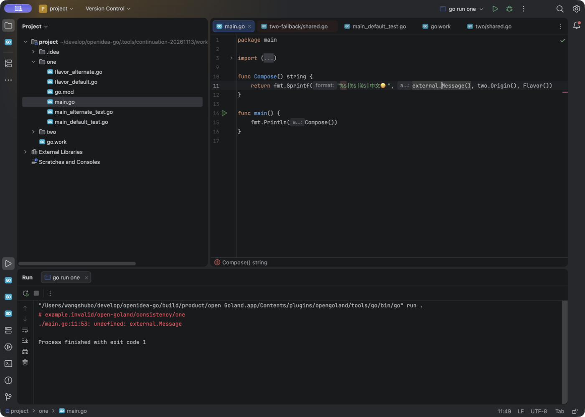
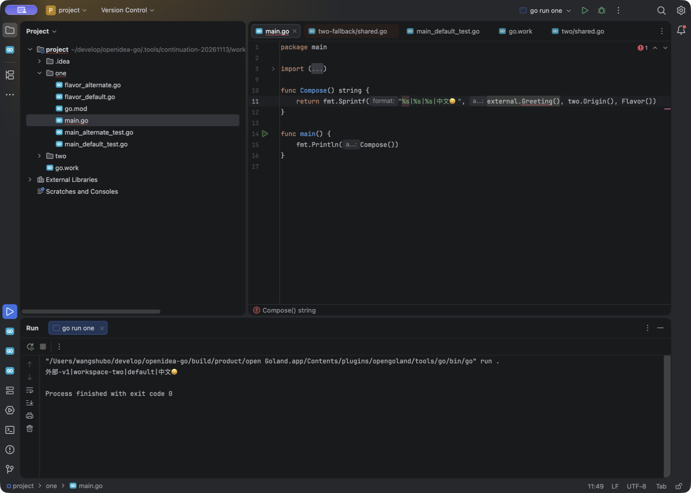
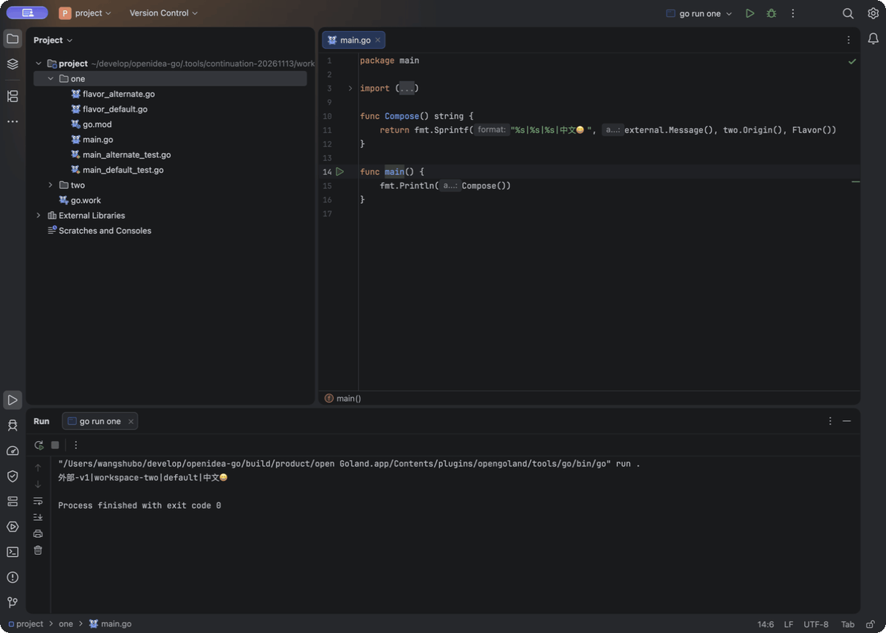

# 项目外 Go 依赖刷新：2026-11-13 原生观察与修复草稿

**状态：固定源码 `cac8501` 的 candidate4 已通过本机限定场景复验，包括冷外部依赖、零参数提示、Run/Test 和最终图标。** 完整本机门禁为 966 项 / 173 报告，另 86 项 Python 通过；新 EXE/DMG 的最终发布核验与完整 GoLand 对齐仍是独立事项。下文各历史阶段不混用源码或产物。

本轮发现的问题很具体：项目通过 `replace` 使用项目目录外的本地模块。在 IDE 从未打开该依赖文件的情况下，外部工具改了函数名，编辑器的分析没有跟上磁盘。结果既出现“编辑器没有报错，但运行编译失败”，也出现“编辑器报错，但运行成功”。

## 固定对象与可复现工程

| 对象 | 本轮固定值 |
| --- | --- |
| 旧 open Goland | `0.1.0-preview.20261113.3`；源码 tag `v0.1.0-preview.20261113.3`，commit `32fd60a43e68a9b879fae0d04ea96bd5ba41547c` |
| 旧版平台 | IntelliJ Platform `2026.1.4` / `261.26222.65`，macOS arm64；原生截图 PID `10884` |
| 官方参考 | GoLand `2026.1.4` / `261.26222.72`，macOS arm64；有效 clean-profile 截图 PID `18853` |
| Go 控制工具 | 实测 `go version go1.26.10 darwin/arm64`；两边按 Go 1.26.10 配置工程 |
| 初始工程 | 两份等价副本，各 15 个文件；集合摘要 `071a4d0da84df543fb1777eea40f5be9a8632c98e15991c1d699d24c6878fe24` |

[启动身份摘要](cold-external-refresh-20261113-evidence/launch-identities.json)记录了启动器 SHA 和 tag 的绑定范围。启动器 SHA 只标识启动器，不能单独代替整个 App 或插件源码的摘要。

提交目录保留了[自有初始工程](cold-external-refresh-20261113-evidence/fixture/)及[逐文件摘要](cold-external-refresh-20261113-evidence/fixture-manifest.json)。`project/go.work` 初始包含 `one`、`two`；项目外有 `external` 和同模块名的 `two-fallback`。`one/go.mod` 的本地替换允许在移除 `two` 工作区成员后选择 fallback。

[CLI 控制记录](cold-external-refresh-20261113-evidence/cli-oracle.json)包含 42 条真实 Go 命令及输出，机器路径前缀已替换为占位符。它只证明已保存文件的 Go 工具行为，不证明桌面分析或未保存 overlay。部分命令的临时 `oracle-probe` 工作目录已经删除，不能把记录中的历史 cwd 当作现存目录。

复现时从 `fixture/project` 运行 `go run ./one`，模块测试使用 `go test -count=1 ./one/... ./two/...`。该根目录自身不是 module；`go test ./...` 的失败不能直接当作 IDE 缺陷。IDE 运行配置应选择整个 package/directory `one`，避免 Files 模式漏掉同包的 `Flavor` 文件。

## 旧版的原生结果

以下使用同一个冻结旧 App。修改 `go.work` 的阶段没有改动 `main.go`，没有手动 Reload 或重启 gopls。

| 操作 | 原生观察 | 结论与证据 |
| --- | --- | --- |
| 初始两个成员 | 对 `Origin` 执行 Cmd+B，进入 `project/two/shared.go` | [初始跳转](cold-external-refresh-20261113-evidence/product-baseline-origin.png) |
| 保存 `go.work`，只保留 `use ./one` | Cmd+B 自动切到项目外 `two-fallback/shared.go`；Run 输出 `外部-v1\|fallback-two\|default\|中文😀`，exit 0 | [跳转与 Run](cold-external-refresh-20261113-evidence/product-fallback-origin-run.png)符合所选依赖 |
| 保持原测试断言，再运行 TestCompose | 原生测试树显示 1 failed；断言是 got `fallback-two`、want `workspace-two` | [真实断言失败](cold-external-refresh-20261113-evidence/product-fallback-test.png)符合 CLI，属于对照成功，不能写成测试本身 PASS |
| 保存恢复两个 `use` 成员 | Cmd+B 返回 `project/two/shared.go`；TestCompose 显示 1 passed、exit 0 | [恢复跳转与测试](cold-external-refresh-20261113-evidence/product-restored-origin-test.png)；此阶段未单独重跑 Run |

随后才测试未打开的项目外依赖：

1. 外部只把 `external/external.go` 中的 `func Message` 改为 `func Greeting`，调用方仍是 `external.Message()`。操作记录时间为 `2026-11-13T10:43:43Z`；调用方仍保持初始摘要 `0ee5aa9189cc3d1d939d2511c62192d5ed5dbf208cf68583fa6279a1dc3de112`。等待数分钟后，编辑器仍显示绿色检查；Run 却真实报告 `main.go:11:53: undefined: external.Message`，exit 1。
2. 保存调用方为 `external.Greeting()` 后，Run 输出正常、exit 0，但 Problems 明确显示 `undefined: external.Greeting :11`，编辑器仍有红线。





[Problems 单独截图](cold-external-refresh-20261113-evidence/product-cold-greeting-diagnostic.png)补充了第二种不一致。这些观察证明编辑器分析与真实编译结果不一致；默认日志没有完整 RPC 轨迹，不能据此指定每一条漏发通知，也不能把“未见补全弹窗”解释为某个 RPC 返回空。

## 官方 GoLand 对照的顺序边界

最初发生自动导入配置的参考启动已经废弃。有效参考使用新的隔离 clean profile，跳过自动导入；没有修改参考应用的安装、用户原配置或许可文件。

主线程操作记录为：Package 模式、Go 1.26.10 的初始 Run 正常；在外部依赖未打开时改名，前台 `main.go` 仍绿，而 Run 报 `undefined external.Message`、exit 1。随后**手动执行 `File > Reload All from Disk`**，再把调用方改为 Greeting；Problems 被观察为空，Run exit 0，Cmd+B 正确进入项目外的 `Greeting`。

本目录只留存了手动 Reload 之后的[Run 成功截图](cold-external-refresh-20261113-evidence/reference-greeting-run.png)和[跳转截图](cold-external-refresh-20261113-evidence/reference-greeting-navigation.png)。初始 Run、Reload 前的不一致和 Problems 空列表没有各自独立的 REA 截图，详见[操作摘要及证据范围](cold-external-refresh-20261113-evidence/reference-operation-summary.json)。

因此，官方的成功结果只证明这条**包含手动 Reload**的操作链，不能与 open Goland 未手动刷新的步骤混合，进而宣称自动行为完全等价或谁更优。

## 第一阶段：给已注册的外部根补充 VFS 监视

第一阶段保留 LSP4IJ 的动态 watcher 匹配和通知路径，并为其注册的项目外根补充后台 VFS 发现及监视。初次只加载目录和文件元数据，不打开源文件或创建编辑器文档。持续前台时，仅对实际拥有的外部根每两秒请求一次异步刷新，同一时刻合并一个进行中的刷新；不强制把整棵树标脏扫描。

当前边界如下：

- 每条注册最多读取 512 个 watcher，单个 pattern 最长 4096 字符；最多成功拥有 128 个根，每根初次物化最多 20,000 项、64 层。
- 拒绝无固定根的 glob、文件系统根、home/项目祖先等过宽范围；项目内目录沿用平台监视。RelativePattern 的 base URI 按字面路径处理，`[` 等目录字符不再被当作 glob。
- 初次安装检查真实路径，避免祖先 symlink 绕过范围限制；不递归 symlink 子目录及 `.git`、`.hg`、`.svn`。目录大小在调用完整 VFS children 物化前先有界检查。
- 只有成功安装的父根才覆盖后代；宽根安装失败后仍尝试合法窄根。安装失败会释放已申请的 watch；无拥有根时不创建刷新 timer。
- 按注册 ID 合并所有权，覆盖重复根；注销、client/server 关闭和项目关闭时释放。安装期间关闭的迟到资源也要回收。

这里的上限是资源保护，不代表超限目录已经被自动分析。注册时不存在的根目前会跳过；整个外部目录删除后重建的重新绑定、新增深层子树，仍需继续实现或验收。

## 第一份候选：测试通过，原生问题仍在

第一份本机候选使用版本字符串 `0.1.0-preview.20261113.4`，**没有发布 tag 或安装器**。它的完整构建门禁为 932 项 / 169 份报告，零失败、错误、跳过；这些结果只属于当时的 `7f42465c…` LSP4IJ 补丁及封存的 570 个输入，集合摘要 `9ac10138…95deef`。插件 JAR 为 `bcc88b57…8eda6`，启动器为 `fd334dad…2d1b6c`，详见[候选阶段绑定](cold-external-refresh-20261113-evidence/candidate1-stage-summary.json)。不能把这份通过数用于后来的 owner 修正、依赖发现或图标改动。

候选 PID `37869` 使用新的隔离 profile，跳过导入后，初始 Package Run exit 0；[初始原生截图](cold-external-refresh-20261113-evidence/candidate1-baseline.png)绑定确切窗口。随后在 IDE 持续前台、外部文件从未打开的条件下，只把 `Message` 改为 `Greeting`；调用方字节未变，仍未观察到自动诊断更新。

为分清原因，之后才启用 verbose trace，并**手动重启 gopls**：PID `44353` 换成 `52201`。重启后的诊断正确报告 `undefined: external.Message`。这次[原生 trace 截图](cold-external-refresh-20261113-evidence/candidate1-trace-registration.png)和[必要协议包摘录](cold-external-refresh-20261113-evidence/candidate1-watcher-packets.json)显示，gopls 注册的是：

```text
**/*.{mod,work}
<fixture>/project/two/**/*.{go,mod,sum,work}
<fixture>/project/vendor/**/*.{go,mod,sum,work}
<fixture>/project/one/**/*.{go,mod,sum,work}
```

这里没有项目外 `external` 的 `.go` 根。全局 mod/work 匹配也不覆盖它的 `.go` 内容变化。因此，仅给“服务器已经注册的根”补 VFS 监视，仍接不到这份外部 Go 文件的变化；这正是第一阶段不足的地方。trace 的 AX 捕获有 20 个缺口，218 个节点且标记为截断；只保留了必要协议值，不能宣称完整 AX 或完整 RPC 抓取。

之后恢复外部 `Message`，没有改调用方或手动刷新。CUA 操作记录观察到 Package Run 成功，而缓存的错误仍在；最终这一反例的独立 REA 截图请求却因 `/usr/bin/xcrun` 超过 60 秒而失败，**没有得到截图或 AX 观察**。[原始结构化错误的安全摘录](cold-external-refresh-20261113-evidence/candidate1-counter-capture-failure.json)保留了缺口。后续 `rea doctor`、`xcrun --find swift` 的诊断不能算作取证恢复或产品问题修复。

## 用真实 gopls 单独验证通知是否有效

两次控制实验直接以 stdio 启动固定 gopls `v0.24.0` 和 Go `1.26.10`，使用各自独立的自有工程；只打开 `one/main.go`，不打开外部依赖，整个过程不改调用方字节或 document version。它们不是原生 IDE 验收。

| 操作 | 文件 URI 通知实验 | 目录 URI 通知实验 |
| --- | --- | --- |
| 初始 Message | 空诊断；definition、hover 指向 Message | 同样正常 |
| 外部改名，不发事件 | 等待 3 秒没有新诊断；新 hover 仍显示旧 Message | 同样保持旧结果 |
| 发送 Changed=2 | `external.go` URI 使调用方出现 undefined Message | `external` 目录 URI 也使已观察文件失效并出现同一诊断 |
| 恢复 Message，再发 Changed=2 | 诊断清空，hover 恢复 Message | 同样恢复 |

[文件事件结果](cold-external-refresh-20261113-evidence/external-file-protocol-control.json)和[目录事件结果](cold-external-refresh-20261113-evidence/external-directory-protocol-control.json)记录了工具摘要、各阶段原始响应值和本机原始帧的 SHA；机器路径已归一化。各保留 55 条消息的本机原始协议，两个自有 gopls 均正常 exit 0，文件恢复。此处提交的是紧凑结果，未复制原始帧文件。

这些结果证明：明确发送通知，能使 gopls 更新**已经读取过**的外部依赖；不能证明 IDE 已经自动发现依赖根、正确经过 OS/VFS/LSP4IJ 发送通知，也不能证明新增文件、整个目录删除重建、Windows 行为或新安装器。后续实现已按已打开 Go package 查询真实依赖、为实际使用的本地 replace 建立独立范围；其相关测试见下文，完整原生链路仍未验收。

## 分阶段回归证据与尚未完成的验收

| 阶段 | 结果 | 证明范围 |
| --- | --- | --- |
| 原实现红测 | 1 项失败 | 动态注册完成后，未打开的外部源文件仍不在 VFS snapshot；[安全 XML 摘要](cold-external-refresh-20261113-evidence/unit-red.xml) |
| 第一版修复 | 7/7 通过 | absolute/relative 冷 VFS、真实 ContentChange、注册失败与所有权/关闭/刷新合并；[绑定源码的阶段摘要](cold-external-refresh-20261113-evidence/unit-summary.json) |
| 两项独立读审回归 | 原实现 2/2 失败，修复后 9/9 通过 | base URI 字面括号、父根失败后窄根回退；[阶段摘要](cold-external-refresh-20261113-evidence/unit-review-summary.json)、[红测](cold-external-refresh-20261113-evidence/unit-review-red.xml) |

测试应用关闭了 fsnotifier，冷 VFS 用例明确补入 dirty marker，再调用生产使用的异步刷新 API。因此这些测试证明 VFS 和生命周期合同，不能代替真实 fsnotifier、gopls 或桌面验收。曾尝试的未真实启动 fakewrapper 通知断言没有形成有效的产品缺陷证明，已[明确排除](cold-external-refresh-20261113-evidence/excluded-notification-peer-attempt.json)，不计入上述通过数。

初始化与能力注册另有一次 owner 修正：旧 client 的异步延续不能在重启之后认领新 client 的 context，也不能删掉新 client 同名的 watcher。相同最终回归源码在 candidate1 上 3/3 失败，修正后的 `d6801a10…` 补丁阶段 29/29 通过：15 项能力生命周期、5 项初始化/封存、6 项外部监视、3 项冷 VFS。公开源码构建器固定 20 个源文件、41 个类，原有 18 个源文件及 36 个类保持字节一致。[阶段摘要与源码哈希](cold-external-refresh-20261113-evidence/owner-stage-summary.json)及目录中的 `owner-final-TEST-*.xml` 保留了绑定。这是实际 wrapper/watch-manager 的受控 SDK 合同测试，仍不等于原生 fsnotifier 到 gopls 的链路通过；本表的 7/9 项、这里的 29 项都不能套到后续依赖发现或图标改动。

独立 Go 引擎检查也已完成：在固定 Go `1.27.3`、匹配 GOROOT、`GOENV=off`、**GOWORK 未设置**的环境中，`go test -race -count=1 ./...` 的 12 个有测试 package 通过，`go vet ./...` exit 0；86 项 Python 检查通过。[独立门禁摘要](cold-external-refresh-20261113-evidence/independent-gates.json)绑定小体积日志。首次 race 检查曾因主进程强制 `GOWORK=off` 而使工作区用例失败；移除这项环境干扰后完整重跑通过，没有改生产代码或断言来换取通过。Go 引擎源码未变，这些检查不能代替当前 Kotlin 依赖发现与图标回归。

新增依赖范围实现的首次定向阶段：**相关 79/79 通过；同次联合运行共 81 项、80 项通过、1 项失败，当次联合门禁未通过。** 唯一失败是 `GoFileIconsTest` 的模板 SVG 可见性断言，不能从历史报告中省略。相关通过项包含 10 项 coordinator、10 项真实所选 Go 的依赖 loader，以及原有运行、能力注册与冷 VFS 合同。[源码绑定与阶段边界](cold-external-refresh-20261113-evidence/scope-stage-summary.json)和 `scope-targeted1-TEST-*.xml` 保留全部 81 个 testcase 的安全摘录；9 个源码/测试哈希与运行前封存清单一致。这是 `3b32dc5` 加本地改动的冻结工作树阶段，不是 clean tag，也不是新 App 通过证明。

该实现为不同打开 package 合并实际使用的本地 replace；部分结果或失败保留旧根及旧元数据，新范围安装、覆盖检查并发送一次目录事件后才卸旧范围，迟到查询不能发布。真实 OS 监视到 UI 的链路仍待验证；整个根删除重建、原本不存在的根出现、深层新增目录和 Windows 原生交付继续开放。每次查询还受 60 秒总期限、30 秒命令时限、2 MiB 输出、20,000 条记录和最多 8 轮元数据闭包限制，不能把触限当作空依赖图成功。

## 11 月 14 日：candidate2 的原生错误与后续修正

candidate2 使用 `0.1.0-preview.20261114.1` 字符串，完整门禁 **959 项 / 172 报告、零失败/错误/跳过**，封存 585 个输入、集合摘要 `5685f609…9a8dbd`，插件 JAR `816212d0…6cccfc`，启动器 `27a814d5…35edbc`。[阶段绑定](cold-external-refresh-20261113-evidence/candidate2-stage-summary.json)只标识这份中间 App，不能用于之后以同一版本字符串重建的候选。

PID `79764` / window `4657` 启动后，owned watcher 注册抛出 `DidChangeWatchedFilesRegistrationOptions` 无法转换为 `JsonObject` 的 `ClassCastException`；[必要错误栈摘录](cold-external-refresh-20261113-evidence/candidate2-owned-registration-error.json)绑定原始日志第 382 行起的错误及完整日志 SHA，没有复制完整日志。这说明“future 完成、VFS 根已物化”仍不足以证明 wrapper 的 matcher 已安装。该候选**没有继续做外部改名**，只完成[深色](cold-external-refresh-20261113-evidence/candidate2-icons-dark.png)/[浅色](cold-external-refresh-20261113-evidence/candidate2-icons-light.png)原生图标视觉观察，随后正常退出、已知 PID 消失；两张截图关闭了 AX 捕获，不是语言功能验收。

后续源码将本地 owned options 经 LSP4J 的 Gson 序列化为 `JsonObject`，并在 client 已关闭时明确拒绝安装；公开补丁仍为 `d6801a10…`。相同真实 wrapper/受控远端测试在旧源码上 **3 项中 2 项失败**，修正后相关 **49/49 通过**。[源码与结果摘要](cold-external-refresh-20261113-evidence/owned-registration-json-stage-summary.json)、`owned-registration-json-red.xml` 和五份 green XML 保留哈希及 testcase。正控实际检查 matcher、冷 VFS 与注销释放，负控检查覆盖失败和 stopped client 拒绝；它们仍不证明真实 OS 事件已经到达原生 UI。

## candidate3：冷依赖链路已有原生结果，参数提示仍阻断发布

candidate3 的完整门禁为 **962 项 / 172 报告，零失败/错误/跳过**；585 个输入摘要 `54b1e48c…740066`，插件 JAR `b0052f17…d13450`，启动器 `20195af0…634c9d`。它仍使用 `.20261114.1` 字符串，不能与 candidate2 或后续重建混同。[源码与原生阶段摘要](cold-external-refresh-20261113-evidence/candidate3-native-stage-summary.json)绑定完整哈希及操作顺序；962 项只覆盖 `d680` 与当时的旧参数提示 handler，不覆盖后续空值修正。

该 App 使用不导入配置的 fresh profile，15 个自有源文件先恢复初始值；PID `33473` / window `6275`，gopls PID `34895`、`34897` 始终未变。以下冷文件阶段没有手动刷新或重启，外部源文件在改名前从未打开：

| 操作 | 原生观察与边界 |
| --- | --- |
| 初始 Message | [初始画面](cold-external-refresh-20261113-evidence/candidate3-baseline.png) |
| 只把外部 Message 改为 Greeting，调用方字节不变 | 自动出现 `undefined: external.Message`，[Problems 与红线](cold-external-refresh-20261113-evidence/candidate3-cold-error.png)已记录 |
| 只恢复外部 Message，调用方仍不变 | 错误自动清除，[恢复画面](cold-external-refresh-20261113-evidence/candidate3-cold-restored.png)已记录 |
| 再次冷改名，再在调用方用 Basic completion | 唯一 `Greeting` 被插入；没有保留补全 popup，不能宣称完整列表已取证。保存后 Run exit 0；Cmd+B 进入外部 [Greeting 定义](cold-external-refresh-20261113-evidence/candidate3-greeting-navigation.png) |
| 原生运行 TestCompose | 首次 `(cached)` 结果不算 fresh 证明。随后在原生 UI 把 Go tool arguments 设为 `-count=1`，实际 `go test -json -count=1 -run ^TestCompose$ .` 显示 [1 passed、PASS、0.581s、exit 0](cold-external-refresh-20261113-evidence/candidate3-uncached-test.png) |

这条操作链同时发现新的阻断：零参数函数补全触发 signatureHelp 后，`LSPParameterInfoHandler.updateUI:143` 对可缺省的 `parameters` 调用 `size()`，抛出 NPE。[必要错误栈](cold-external-refresh-20261113-evidence/candidate3-signature-help-error.json)摘自日志第 336 行起；没有复制完整日志。后续已写入这个上游可选值处理的修正，**candidate3 没有发布**，其原生结果不能证明修改后的 handler 已通过。

后续空值修正使用补丁 `6e5f7e12…584fef`：缺失参数列表沿用原有空列表的本地化展示，不据此推断函数的真实参数个数，也不关闭参数提示。相同回归源码在旧实现上 4 项中仅空值一项失败；修正后实际 handler 4 项及既有初始化/封存 5 项合计 **9/9 通过**。[阶段摘要](cold-external-refresh-20261113-evidence/signature-help-null-stage-summary.json)与三份 `signature-help-null-*.xml` 保留源码绑定和红绿结果。公开源码构建器现为 21 源 / 42 类，原有 20 个源及 41 个类逐字节未变；该源码阶段没有启动 popup，后续原生结果见 candidate4。

图标随后也有一项细化：测试文件角标由试管改为独立绘制的红绿方向三角。candidate2/3 截图只证明当时的蓝色 Gopher、功能侧栏及旧测试角标；最终图标的原生深浅主题结果见 candidate4。

App 正常退出后，[收尾摘要](cold-external-refresh-20261113-evidence/candidate3-post-quit.json)记录 4 个已知 PID 消失、15 个自有源文件恢复，`codesign --verify --deep --strict` exit 0；这不代表公证或未采样子进程均已核验。新源码仍需重新打包和复验补全/参数提示及依赖链路，再完成新 tag、Windows EXE/macOS DMG 发布。Windows 原生交互、整个根删除重建、深层新增目录、GUI build tags 与未保存 overlay 继续开放；当前局部成功不能替代完整矩阵。

## candidate4：固定源码的最终本机复验

本机 App 来自固定提交 **`cac85013896b0508d88dab9f8c42d5bbc388fec0`**，版本为 `0.1.0-preview.20261114.1`。586 个封存输入摘要 `59dd547a…3f4c02` 已逐个与该 Git 提交的原始 blob 独立核对；内置 engine 的 VCS 元数据同为此提交、`modified=false`。插件 JAR 为 `302a326b…6c8520`，启动器为 `0685a656…a9dcbc`。[输入与关键产物提取](cold-external-refresh-20261113-evidence/candidate4/source-inputs.json)、[原始构建时摘要](cold-external-refresh-20261113-evidence/candidate4/build-summary.json)和[最终原生摘要](cold-external-refresh-20261113-evidence/candidate4/native-summary.json)分别保留绑定；构建时的 pending 状态按历史原样保留。

原始 [173 份 XML 压缩包](cold-external-refresh-20261113-evidence/candidate4/test-results.tar.gz)独立统计为 **966 项、零失败/错误/跳过**；[Python 日志](cold-external-refresh-20261113-evidence/candidate4/python-tests.log)为 86 项通过。原生实例 PID `57781` / window `6525` 使用同一 Go runtime，gopls PID `57942`、`57943` 未变：

| 实际操作 | 结果与证据 |
| --- | --- |
| 外部源文件从未打开，只在磁盘把 Message 改为 Greeting | 调用方字节不变，自动出现 [undefined Message](cold-external-refresh-20261113-evidence/candidate4/cold-error.png)；没有手动刷新或重启 |
| 只恢复外部 Message，再次冷改名 | 第一次恢复后自动[清除诊断](cold-external-refresh-20261113-evidence/candidate4/cold-restored.png)，第二次变化仍被感知；之后才编辑调用方 |
| Basic completion：Gree → Greeting，再 Cmd+P | 唯一 Greeting 自动插入；没有保留 completion popup。实际参数提示显示 [`<no parameters>`](cold-external-refresh-20261113-evidence/candidate4/no-parameters.png)，本次未再触发旧 NPE |
| 保存调用方、Run、Cmd+B | 输出 `外部-v1\|workspace-two\|default\|中文😀`，exit 0；跳到项目外 [Greeting 定义](cold-external-refresh-20261113-evidence/candidate4/greeting-navigation.png) |
| 原生 TestCompose，Go tool arguments 为 `-count=1` | 实际 `go test -json -count=1 -run ^TestCompose$ .`：[1 passed / PASS / package 0.689s / exit 0](cold-external-refresh-20261113-evidence/candidate4/uncached-test.png) |
| 最终图标 | [深色](cold-external-refresh-20261113-evidence/candidate4/baseline.png)与 [Islands Light](cold-external-refresh-20261113-evidence/candidate4/light-icons.png)均观察到透明 Gopher、红绿测试角标、mod/work 区分和功能侧栏 |

正常退出后，[收尾完整性记录](cold-external-refresh-20261113-evidence/candidate4/post-quit.json)确认 4 个已知 PID 消失、15 个自有源文件恢复，586 输入、manifest、插件及启动器摘要不变；`codesign --verify --deep --strict` exit 0，整个本次日志没有 SEVERE/ERROR 命中。已知 PID 范围不扩展为未采样子进程证明，签名结构检查也不等于公证。



这份 [GIF 录制记录](../demo/native-go-workflow-20261114-recording.json)绑定三张最终 REA 原生截图，每张停留 4 秒，共 12 秒；只作统一缩放与 GIF 调色，没有补画 UI、光标或注释。它是实际操作阶段画面，未伪装成连续录像。七张原图均关闭 REA AX 捕获；参数提示的 CUA AX 观察与截图分别记录。

以上只证明这份固定源码在本机、自有工程和所述操作链的结果，不宣称与随后 CI 的 EXE/DMG 字节相同。**36 × 2 验收矩阵继续开放**：Windows 交互、macOS 调试权限、整个外部根删除重建、深层新增目录、资源上限之外的工程及其他未覆盖工作流仍需独立验收。

截至本稿，实际保留 **7 组旧 product、2 组 reference、2 组中间 candidate1、2 组 candidate2 图标、5 组 candidate3、7 组最终源码 candidate4** 的 PNG 与 REA 元数据摘要，另保留必要失败摘录，详见[文件及 SHA 清单](cold-external-refresh-20261113-evidence/manifest.json)。没有用截图代替未保留的补全 popup；提交目录没有完整 AX、profile、config、许可文件或完整 `idea.log`。

原始 product、gopls 与参考实例的已知 PID 均已消失。桌面工具随后额外打开的无工程实例不计入验收，并已按确切生成应用进程清理。两份自有工程的 15 个初始源文件均已恢复。检查无运行依赖和打开文件后，清理了三套已结束的隔离配置/索引，实测可用空间增加 1,762,250,752 字节；保留共享 SDK、参考应用、当前产品 App 和紧凑证据。
