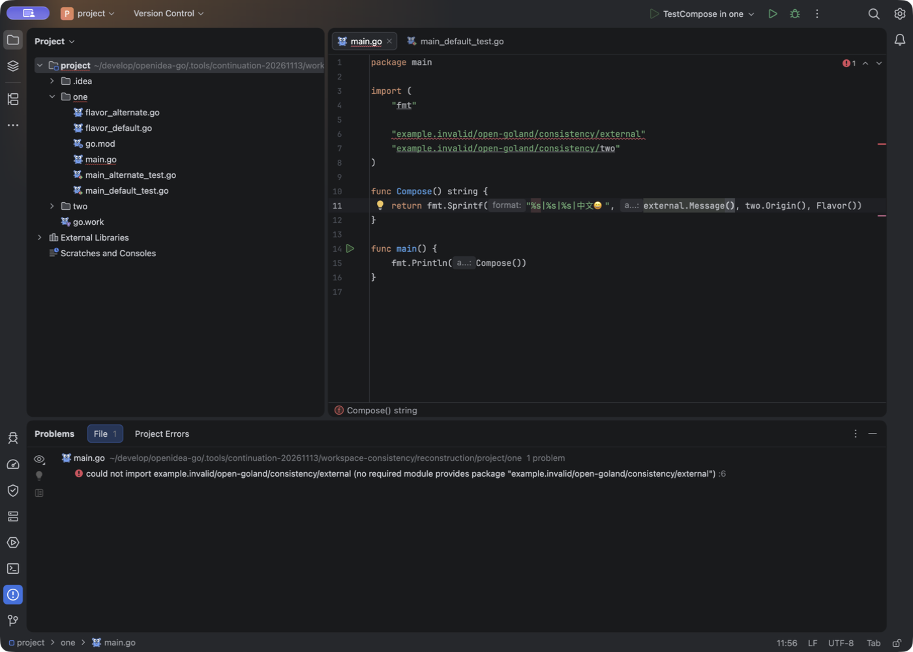
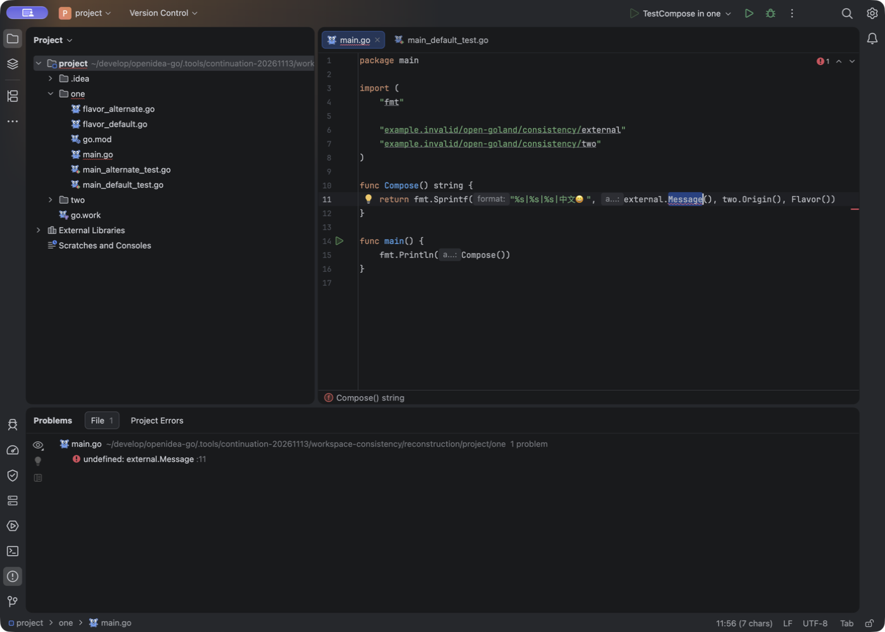

# 项目外依赖目录删除、重建：2026-11-14 失败记录

**当前：固定提交 `643480a` 的 candidate9 完成本机 981 项/175 报告，并通过默认 bundled gopls 的整根删除、重建、原生 Run 和无缓存 Test；14.3 的双平台 CI 与公开安装器仍待完成。** 已发布 `.20261114.2` 与中间 candidate8 的原生失败保留在各自阶段，不改标为成功。本记录区分原生观察、受控协议、源码检查和交付证据，完整工程语义及 72 项矩阵仍开放。

## 固定对象

| 对象 | 本次绑定 |
| --- | --- |
| 本机 App | C5 源码 `07ae69f3b2bbc36f3221ff08e8fe9046f199b624`，版本 `0.1.0-preview.20261114.2` |
| 身份 | manifest `5dfd710b…48cfce`；启动器 `b928f4e8…d9fd07`；App PID `57904`、window `9256` |
| 系统与配置 | macOS arm64；沿用自有的 C7 隔离配置，不是重新创建的干净配置 |
| 工程 | 原有双模块 `go.work` 工程，`one` 通过本地 `replace` 使用项目外 `external` |
| 调用方 | 保持 `external.Message()`；`main.go` SHA `0ee5aa91…de112`，本次目录操作不修改调用方 |

[启动记录的规范化副本](external-root-recovery-20261114-evidence/launch.normalized.json)保留了 15 个初始源文件摘要。这次启动的是此前已封存的本机 App；[公开安装器证明](../verification/releases/0.1.0-preview.20261114.2.json)与[发布控制层证明](../verification/releases/0.1.0-preview.20261114.2-publication.json)独立记录真实 EXE、DMG 和五份资产核验，不能据此声称本机 App 与 CI 安装器逐字节相同。

## 原生操作与反例

| 操作 | 磁盘与真实 Go 结果 | 编辑器观察 |
| --- | --- | --- |
| 基线 | 原外部根存在，调用方仍使用 `Message` | [基线原图](external-root-recovery-20261114-evidence/baseline.png)：绿色检查，Problems 为 `No problems in main.go` |
| 将整个原外部根移到保留目录，原依赖路径消失 | 原根 inode `86979628`；`go run` exit 1，找不到被替换模块的 `external/go.mod` | [缺根原图](external-root-recovery-20261114-evidence/root-absent.png)：调用方仍绿色、Problems 仍无问题 |
| 在同一路径创建新外部根，新文件定义 `Greeting`、不再定义 `Message` | 新根 inode `90088901`，与原根不同；调用方不变，`go run` exit 1，`undefined: external.Message` | [重建原图](external-root-recovery-20261114-evidence/root-recreated.png)：仍未显示这一编译错误 |

这里没有销毁原依赖数据：先移开并保留原根，再创建不同 inode 的新根，以验证原路径的对象替换。两次操作回执均记录 `callerModified=false`、`manualReload=false`、`goplsRestart=false`。[缺根操作副本](external-root-recovery-20261114-evidence/root-absent-operation.normalized.json)与[新根及 Go 编译副本](external-root-recovery-20261114-evidence/root-recreated-greeting-operation.normalized.json)保留了命令退出码、错误和原始记录的 SHA。

本轮只比较已保存磁盘内容、实际 Go 编译和保留画面中的当前文件诊断。截图没有完整协议轨迹，不能单凭它指定某条 RPC 漏发，也没有执行官方 GoLand 的同场景对照。

## 记录过程的缺口

- 缺根操作最初的同名 JSON 被后续截图元数据误覆盖；现有操作回执的字段由原本成功的工具输出恢复。**没有保留最初 JSON 的原字节**，规范化副本和清单均明确这一点。
- 创建新根的文件系统操作已经发生，随后记录器的一次断言查找失败；之后重新执行的是只读 Go 编译检查。不能将该次记录器失败解释为“目录没有创建”，也不能声称创建与复核是一条无中断事务。
- 缺根 REA 捕获启用了 AX，但仅得到 120 个节点，存在截断和 15 个子节点计数缺口；此处仅保留紧凑元数据，不复制完整 AX。基线、重建两帧关闭了 AX 捕获。三张 PNG 均保留原字节，没有补画或修改 UI。

## 独立 VFS 回归同样失败

在 `9a8ba2e9f571c0283b5bc136cb50b40a0c6610bb` 基线上只新增回归测试，没有修改生产实现。测试通过现有 `NativePlatform` 注册冷根，先确认真实内容变更事件，再移开整个根并确认真实删除事件、旧 `VirtualFile` 已失效。随后原路径创建新目录和未打开的 Go 文件，再调用生产 `requestRefresh`；新文件仍未进入 VFS，断言失败。

结果为 **1 项、1 失败、0 错误、0 跳过**，失败位置是 `GoExternalRootRecoveryVfsTest.kt:78`。测试环境没有原生 fsnotifier，使用受控 dirty 标记和真实 VFS 刷新；它不证明正在运行的 gopls 或桌面协议链路。[规范化 XML 摘录](external-root-recovery-20261114-evidence/red-vfs-test.normalized.xml)保留用例、失败和源码帧；[安全摘要](external-root-recovery-20261114-evidence/red-vfs-summary.normalized.json)保留原 XML 的大小及 SHA，未复制其中的完整系统日志。[原测试源码](external-root-recovery-20261114-evidence/red-test-source.original.kt)保留当次字节，[来源绑定](external-root-recovery-20261114-evidence/red-source-binding.json)确认 C5 与测试基线的生产 watcher 文件 Git blob 相同。

## 显式目录通知的真实 gopls 控制通过

另起一个真实 gopls stdio 进程，使用 Go `1.26.10 darwin/arm64`、gopls `0.24.0` 和单独的自有工程副本。只发送一次 `didOpen main.go`、版本始终为 1，从不打开外部文件，也不发送 `didChange`。探针显式发送三次 `workspace/didChangeWatchedFiles`，每次都是外部根目录的 `Changed/type=2`：

| 显式通知之前的磁盘状态 | gopls 实际诊断 |
| --- | --- |
| 原根已移走、依赖路径缺失 | `compiler / BrokenImport`，无法导入外部模块 |
| 同路径新 inode 的根定义 `Greeting`，调用方仍用 `Message` | `compiler / UndeclaredImportedName`，`undefined: external.Message` |
| 新根源码恢复 `Message` | 诊断清空，hover 再次返回 `external.Message()` |

调用方字节未变，gopls 正常 exit 0。独立解析原始帧确认 client 21 条、server 44 条；三阶段诊断均能在真实 server 帧中找到。[规范化紧凑结果](external-root-recovery-20261114-evidence/protocol-control.normalized.json)保留工具摘要、所选环境、输入通知和诊断，以及原 `client.frames`、`server.frames`、协议记录和探针脚本的大小/SHA；没有复制原始帧或整个脚本。gopls 自身由 Go 1.27.3 编译，这与本次选择的工程 Go 1.26.10 是不同信息。

这里证明的是：**明确通知后，gopls 能感知根消失、新根出现及源码恢复。** 它不证明 IDE 已自动发现变化，也不证明 fsnotifier/VFS/LSP4IJ 正确传递通知；上面的原生和 VFS 结果仍是 RED。探针在最终打印前采样了 `control.stdout`，当时记录为空，完成后为 5,187 字节；紧凑结果同时保留采样值与最终实际摘要，没有把两者当作相同原字节。

## 恢复与范围

退出前已恢复全部 15 个源文件初始摘要，并把原 inode `86979628` 的目录放回原位置；新建根另行保留。正常退出后，4 个已采样自有 PID `57904` / `57908` / `58107` / `58108` 均不存在，最终应用列表显示自有 App 已关闭。本次新增日志段未见 ERROR/SEVERE，产品 manifest 未变，`codesign --verify --deep --strict` exit 0。[退出前副本](external-root-recovery-20261114-evidence/prequit.normalized.json)、[原字节退出记录](external-root-recovery-20261114-evidence/postquit.original.json)界定了这些检查；它们不证明未采样进程全部退出，也不等于公证或完整 App 字节复验。

本轮没有证明 IDE 自动成功恢复、初始不存在的根自动出现、深层新增子树、Windows 交互或完整 `PROJECT-02` 通过。显式协议控制的成功与原生失败分别保留；后续修复与新交付应另行记录，不能用当前失败帧冒充修复后的证据。

[证据清单](external-root-recovery-20261114-evidence/manifest.json)逐文件记录大小与 SHA。带 `normalized` 的文件是明确标注的派生副本，替换了机器路径前缀；它们不是原始 JSON/XML。原 PNG、当次测试源码和小体积退出记录则保留原字节。未复制 profile、配置、许可文件、完整 AX 或完整 `idea.log`。

## 工作树修复与定向验证

修复保留固定的依赖路径，重新检查目录身份。旧根消失时释放旧 OS 监视；同路径出现新目录后，重新执行安全范围及数量/深度检查，再建立监视和 VFS 快照。目录变化通过真实客户端连接异步通知 gopls；通知失败不丢弃待重试状态，旧连接或旧根不能把迟到结果发布到新连接/新所有者。已失效的逻辑父根不能遮蔽仍可监视的窄根；VFS 把旧根移动到别处时，也不能继续刷新移动后的树。

最终冻结工作树的 **37 项 / 4 类定向检查全部通过，零失败、错误、跳过**。其中真实 VFS 检查覆盖先消失再重建、快速换目录但旧对象仍有效、旧 VFS 根已移动后的范围约束。首次原生反例和红测仍保留；第一轮 35 项有 2 项失败、第二轮 36 项有 1 项失败，修复刷新时序后第三轮 36 项通过，补移动范围约束后最终 37 项通过。[分阶段结果和源码摘要](external-root-recovery-20261114-evidence/working-tree-green.normalized.json)保留准确边界及原 XML 摘要。

这些是工作树受控检查，不是新 App 的桌面通过证明。首次就不存在的外部根、稳态深层新子目录、Windows 交互仍未由本轮证明；完整构建、原生重放和新版本双安装器交付继续推进。

## candidate8：固定修复提交的本机完整构建

修复现已提交为 **`89dc532aac60678f875c3b4c3740aab709172ea3`**，本机候选版本为 `0.1.0-preview.20261114.3`。[原始构建摘要](external-root-recovery-20261114-candidate8/build-summary.original.json)保留构建完成时的状态：完整本机门禁与独立 App 组装已完成，新的原生、CI、发布验收待进行。它不是已发布版本的声明。

独立核对 [590 个封存输入](external-root-recovery-20261114-candidate8/source-inputs.original.json)：路径集合与固定 Git 提交的全部构建输入一致，每个原始 Git blob 的 SHA 均匹配，集合摘要为 `7c2ec4c0…0816e8`。engine 的 VCS revision 同为 `89dc532`、`modified=false`。保存的完整 manifest SHA 为 `b3b1438e…2908c0`；[紧凑提取](external-root-recovery-20261114-candidate8/product-manifest.selected.json)记录插件 JAR `e8fa8c88…6eeae2`、启动器 `da8cc49c…7060f3` 及关键产物摘要，不复制整个 App 或完整 4.9 MB manifest。

| 独立核对对象 | 本机结果 |
| --- | --- |
| [原字节 JUnit 压缩包](external-root-recovery-20261114-candidate8/test-results.original.tar.gz) | 175 份原始 XML，977 个唯一 testcase，零失败、错误、跳过；压缩包 SHA `8dc2ff34…15cf8a` |
| 目录恢复定向用例 | 本次完整报告中，真实 VFS 恢复类 3 项、watcher 生命周期类 10 项均通过；具体用例名称保留在[独立核对记录](external-root-recovery-20261114-candidate8/independent-verification.json)，不拿这 13 项代替全部工程语义验收 |
| [Go race 原日志](external-root-recovery-20261114-candidate8/go-race.original.jsonl)及[驱动摘要](external-root-recovery-20261114-candidate8/go-race-summary.original.json) | 重新解析得到 349 个测试通过事件、12 个 package 通过；命令 package 没有测试，产生 1 个包级 skip，没有测试级 skip、失败或缓存事件 |
| Go 源码对照 | 123 个 Go 源文件的集合及原始 Git blob SHA 与已发布 C5 源码逐项相同；engine 仍重新构建并记录当前提交，不能沿用旧 revision |
| 构建封存 | 构建摘要记录 `codesign --verify --deep --strict` exit 0；不等于公证或新 App 桌面验收 |

Go 驱动摘要记录使用匹配的 Go 1.27.3/GOROOT、`go test -race -count=1 -json ./...`，GOWORK 未设置。本次文档核对重新读取原日志与不可变 Git blob，没有重跑 Go 或 Gradle。原始 XML 压缩包保留完整原字节；[本阶段独立清单](external-root-recovery-20261114-candidate8/manifest.json)逐文件给出大小与 SHA，之前 RED/工作树阶段清单不变。

**本节只证明固定提交的本机构建和受控检查。** 原构建记录保留当时的 native/CI/release pending 状态；下述后续原生重放未通过，不能倒写为构建阶段已验收。`.20261114.3` 尚未由本节建立 tag、双平台 CI 或公开安装器证明。原 `.14.2` 原生失败、首次缺根和深层新增目录边界，以及完整 `PROJECT-02`/72 项矩阵均不因此关闭。

## candidate8：原生重放仍失败，不能发布

同一固定 C8 App 使用新建的隔离 system/plugins/log 目录及复制的自有 C7 配置，不是干净默认配置。[启动副本](external-root-recovery-20261114-candidate8/native-launch.normalized.json)绑定版本、源码和 manifest；App PID `84426`、window `9613`，gopls `84551` / `84553` 在所述阶段保持身份不变。原生 `-version` exit 0，仍有 WARN/Unsafe 警告，没有 ERROR/SEVERE；不称零警告。

| 实际阶段 | 磁盘与独立 Go CLI | 原生当前文件诊断 |
| --- | --- | --- |
| [基线](external-root-recovery-20261114-candidate8/native-baseline.png) | 原根 inode `86979628`，CLI exit 0，输出中文/emoji | 无问题；实际 F1 显示 `external.Message() string` |
| [整个根移走](external-root-recovery-20261114-candidate8/native-root-absent.png) | CLI exit 1，缺少外部 `go.mod` | 自动报告无法导入外部模块，符合缺根状态 |
| [原路径重建 Greeting 新根](external-root-recovery-20261114-candidate8/native-root-recreated-failure.png) | 新 inode `90386408`，CLI 已报 `undefined: external.Message` | 仍停在第 6 行无法导入模块，未跟上重建后的实际错误；本次候选失败 |
| [只把新根源码恢复 Message](external-root-recovery-20261114-candidate8/native-source-restored.png) | 根 inode 不变，CLI exit 0 | 自动清除诊断 |
| [同一新根再改 Greeting](external-root-recovery-20261114-candidate8/native-steady-greeting.png) | CLI exit 1，`undefined: external.Message` | 自动显示第 11 行 undefined，符合本次普通文件变化 |
| 放回原 inode 的原目录 | 15 个源文件摘要恢复，CLI exit 0 | 没有对应的最终原目录恢复截图；不能拿上一张新根源码恢复图替代 |

[六份操作回执的规范化副本](external-root-recovery-20261114-candidate8/native-operations.normalized.json)逐份保留原始输入大小/SHA。调用方 `main.go` 始终为 `0ee5aa91…de112`，没有手动 Reload 或重启 gopls。表中的 Go 执行结果均来自独立 CLI，**本轮没有执行原生 Run/Test**，不借用旧测试面板或旧通过记录。关闭 Auto Test 的一次屏外点击被工具拒绝，也不声称相关设置已成功改变。

正常退出后，[原字节收尾记录](external-root-recovery-20261114-candidate8/native-postquit.original.json)确认 4 个已采样自有 PID 均不存在、15 个源文件恢复、manifest/启动器/关键 JAR 未变，codesign 深度严格检查 exit 0，所检查日志没有 ERROR/SEVERE。[失败摘要](external-root-recovery-20261114-candidate8/native-failure-summary.json)保留 `releaseEligible=false`；五张原 PNG 均关闭 AX 捕获，不复制 profile 或完整日志。普通新根文件变化能刷新，仍不能替代整根重建成功。

## 带子文件删除和等待的控制没有复现

为检验通知组合，在全新的自有工程副本启动真实 gopls：只 `didOpen main.go` 版本 1、没有 `didChange`。先移走根并显式发目录 Changed，得到 BrokenImport；再分别发 `go.mod` 和 `external.go` 的 Deleted，实际等待 12.005 秒后创建 Greeting 新根，仅发目录 Changed。

这次控制**没有复现原生失败**：目录通知后已经收到 `UndeclaredImportedName / undefined: external.Message`。再发 `go.mod` Created 与源码 Changed，没有新的诊断发布，原结果已正确，不能称这些额外通知修好了控制。最后只恢复源码并发文件 Changed，诊断清空。每个后续观察窗约 15 秒，主文件字节不变，gopls 正常 exit 0。

[紧凑反例记录](external-root-recovery-20261114-candidate8/protocol-children-order-counterexample.normalized.json)保留 29 条 client / 66 条 server 原帧的大小/SHA、探针来源摘要、七次实际通知顺序和阶段原始诊断身份；原帧继续留在 ignored 工作区。它只排除了该显式组合在这份夹具中必然失败的解释，不能证明 IDE 实际发送了相同消息，也不能确定 C8 原生失败的根因。后续原生读流取证与修复应另列，当前不下结论。

## C8 第二轮：实际读流消息暴露目录 URI 差异

第二轮沿用同一冻结 C8 App 和隔离配置，仅在自有工程选择一个 exec 包装脚本，让它启动同一个 bundled gopls，附加官方 `serve -rpc.trace -logfile` 参数；没有修改 App、SDK 或参考 IDE。[本轮启动记录](external-root-recovery-20261114-candidate8/r2-launch.normalized.json)绑定真实 gopls SHA `d4b779c2…591f`、包装脚本摘要与配置变更范围。本轮[失败原图](external-root-recovery-20261114-candidate8/r2-root-recreated-failure.png)独立于前五帧，仍是新根已出现而诊断停在无法导入模块。

实际 gopls 日志为 **35,180 字节，SHA `84c89d88…4df2b`，81 条消息**。[选取的真实消息](external-root-recovery-20261114-candidate8/r2-trace.selected.normalized.json)已经重新从原日志解析比对；[日志规范化副本](external-root-recovery-20261114-candidate8/r2-gopls-rpc.normalized.log)只替换机器路径前缀，保留 URI 结尾：

| 日志顺序 | gopls 实际读到的目录 Changed | 随后的主文件诊断 |
| --- | --- | --- |
| ordinal 50，根存在 | `.../external/`，有尾斜杠 | 基线原本无诊断 |
| ordinal 54，根缺失 | `.../external`，无尾斜杠 | ordinal 56 发布 BrokenImport |
| ordinal 59，新根 Greeting 已出现 | `.../external/`，有尾斜杠 | 未发布更新诊断，原生仍停在无法导入模块 |

这是 `NewHeaderStream` 解码后、gopls `LoggingStream` 保存的**消息层记录，不是原始 Content-Length 线缆字节**。源码 `internal/protocol/log.go` 中，`Read` 成功后使用客户端视角标签 `Sending`，实际表示 gopls 从 stdio 读入；`Received` 则是 gopls 的输出日志，记录在底层 Write 之前，不等于写入确认。源码大小/SHA 与字段解释保存在选取记录中，避免误读方向。

[本轮四份操作记录](external-root-recovery-20261114-candidate8/r2-operations.normalized.json)仍区分 CLI 与原生观察。正常退出后，[收尾副本](external-root-recovery-20261114-candidate8/r2-postquit.normalized.json)确认 4 个已采样自有 PID 消失、15 个源文件恢复、临时工程 Go 设置恢复原本不存在的状态、manifest 未变、codesign exit 0、无 ERROR/SEVERE；配置正文不公开。收尾成功不改变本轮功能失败。

## 仅改变 URI 尾斜杠的真实 gopls 对照

在另一份全新自有工程和 gopls 进程中，调用方只 didOpen 一次、始终版本 1，不发 didChange。先让缺根的无斜杠目录通知产生 BrokenImport，再按下列顺序控制输入，每个观察窗约 5 秒：

| 控制输入 | 实际结果 |
| --- | --- |
| 创建含 Greeting 的新根，只发 `.../external/` Changed | 仍停在 BrokenImport，复现不一致（RED） |
| 不改任何文件、根 inode 或主文件版本，只再发 `.../external` Changed | 更新为 `undefined: external.Message`，与实际源码相符（控制 GREEN） |
| 恢复 Message 源码，再发无尾斜杠目录 Changed | 诊断清空 |

[精确对照结果](external-root-recovery-20261114-candidate8/protocol-directory-slash.normalized.json)保留 22 条 client / 48 条 server 原帧的摘要、四次实际输入、阶段原始诊断及工具身份；原帧留在 ignored 工作区。main 字节未变，gopls 正常 exit 0。此前统一使用 Python 无尾斜杠 URI 的控制没有复现，这一反例仍保留，不被改标。

本组证据明确区分实际 C8 消息与显式控制通知。生产端的词法 URI 规范化和 FIFO 修正仍属于后续源码验证；此处没有新 App 原生通过、Windows/Mac CI、tag 或公开安装器证明，C8 仍不能作为 14.3 发布。

## candidate9：默认 bundled gopls 的本机原生通过

candidate9 来自固定提交 **`643480a3d9d01c526210bdeba16df8431c1f4d75`**，候选版本为 `0.1.0-preview.20261114.3`。目录补发通知复用同一 FIFO，并使用不受磁盘目录存在性影响的词法 URI；Client 源码 SHA 为 `f73db33a…0dbe02`。独立核对 [590 个原封存输入](external-root-recovery-20261114-candidate9/source-inputs.original.json)与全部原始 Git blob 一致，摘要 `895ae89d…08644`；engine VCS 为同一提交、`modified=false`，完整 manifest SHA 为 `8e5bb04a…538e7`。

[175 份原始 XML](external-root-recovery-20261114-candidate9/test-results.original.tar.gz)独立统计为 **981 个唯一用例，零失败、错误、跳过**。本阶段 [Go race 复用记录](external-root-recovery-20261114-candidate9/go-race-reuse.json)明确没有重新执行 C9 race：123 个 Go 源文件及 go.mod/go.sum 与 C5、C8 原始 Git 内容相同，引用前次真实 349 个测试通过、12 个包通过记录；不能将它写成 C9 新执行。其他独立核对见[来源记录](external-root-recovery-20261114-candidate9/independent-verification.json)。

新 App PID `99982`，使用默认 bundled gopls `113` / `114`，没有 exec trace 覆盖；自有 C8 配置作为种子，system/log 为新目录，不是干净默认配置。所述阶段 gopls 身份保持不变，调用方 `main.go` 始终为 `0ee5aa91…de112`，没有手动 Reload、重开工程或重启服务。[本轮原生摘要](external-root-recovery-20261114-candidate9/native-summary.json)与[启动副本](external-root-recovery-20261114-candidate9/native-launch.normalized.json)保留固定绑定。

| 本机实际操作 | 原生结果 |
| --- | --- |
| [基线](external-root-recovery-20261114-candidate9/native-baseline.png) | 当前文件无问题 |
| [移走整个原外部根](external-root-recovery-20261114-candidate9/native-root-absent.png) | 自动报告无法导入外部模块，与缺根 CLI 错误一致 |
| [原路径创建 Greeting 新根](external-root-recovery-20261114-candidate9/native-root-recreated.png) | 新 inode `90673515`；无需额外源码编辑，自动更新为第 11 行 `undefined: external.Message`，不再卡在旧导入错误 |
| [仅恢复新根中的 Message](external-root-recovery-20261114-candidate9/native-source-restored.png) | 自动清除诊断，根 inode 保持不变 |
| [原生无缓存 TestCompose](external-root-recovery-20261114-candidate9/native-uncached-test.png) | 实际 `go test -json -count=1 -run ^TestCompose$ .`，1 passed / 840ms / package 0.365s / exit 0，未使用结果缓存 |
| [原生 Run](external-root-recovery-20261114-candidate9/native-run.png) | bundled Go 执行 `go run .`，输出 `外部-v1\|workspace-two\|default\|中文😀`，exit 0 |

[五份磁盘操作副本](external-root-recovery-20261114-candidate9/native-operations.normalized.json)仍将 CLI 控制与真实[原生 Test](external-root-recovery-20261114-candidate9/native-test.normalized.json)、[原生 Run](external-root-recovery-20261114-candidate9/native-run.normalized.json)分别记录。Run/Test 在新根 inode `90673515` 中完成；随后放回原目录 inode `86979628`，15 个源文件恢复初始摘要。

正常退出后，[收尾副本](external-root-recovery-20261114-candidate9/native-postquit.normalized.json)记录 4 个已采样自有 PID 消失、manifest/启动器/关键产物未变、codesign 深度严格检查 exit 0、所检查日志无 ERROR/SEVERE。版本查询仍有 WARN/Unsafe 警告，不称零警告。六张 PNG 保持原字节，所选元数据和操作记录则明确标为规范化副本，完整 profile、配置正文和 idea.log 不公开；[独立清单](external-root-recovery-20261114-candidate9/manifest.json)逐项记录大小/SHA。

**这是固定源码在本机 macOS 的有限通过，尚不等于 14.3 已交付。** Windows/Mac CI、公开 EXE/DMG 另待实际证据；本机 App 不声称与未来 CI 安装器逐字节相同。首次不存在的根、稳态深层新增子树、Windows 交互及完整 PROJECT-02/72 项矩阵不由本轮关闭。原构建摘要仍保留构建时的 pending，C8 与 `.14.2` 的历史失败均原样保留。

上述 [41 项定向检查](external-root-recovery-20261114-repair-controls/summary.json)覆盖稳定 URI、FIFO 排队、旧连接/所有者隔离和真实 VFS 恢复；排序与 URI 的原始红测分别保留。定向检查本身不代表 App 或安装器通过；C9 的完整打包与有限原生重放由本节独立记录，双平台交付另以发布记录为准。
