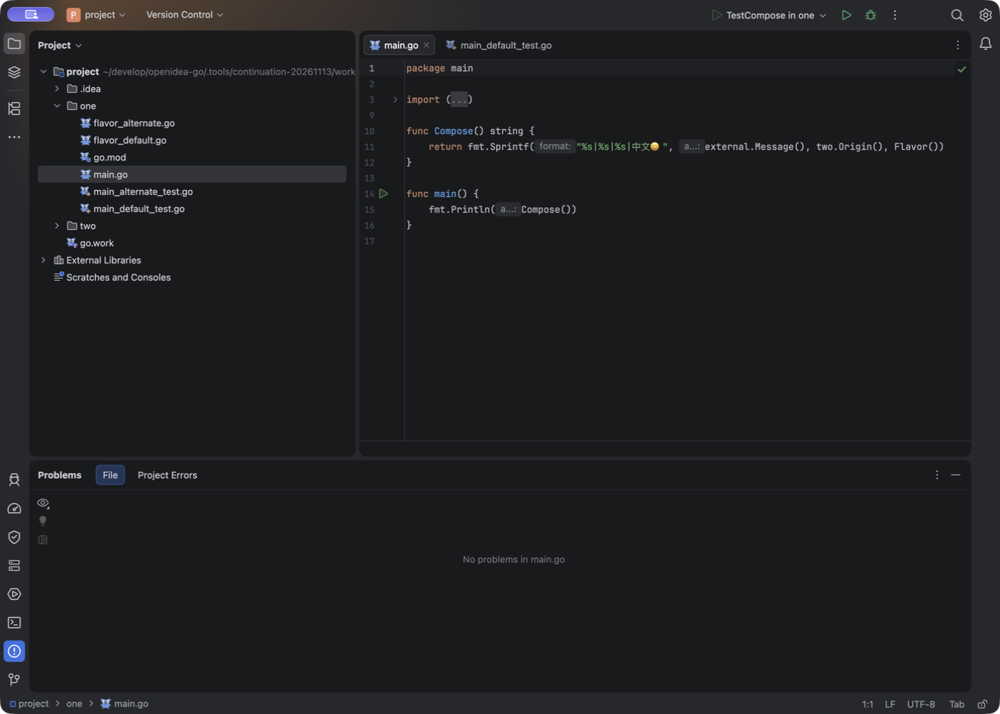

# 项目外依赖目录删除、重建：2026-11-14 失败记录

**已发布的 `.20261114.2` 在本场景是原生 RED；修复工作树已通过 37 项定向测试，新 App 和安装器尚待验证。** 已公开的 `0.1.0-preview.20261114.2` 对既有外部文件改名有成功记录，但本次发现了更完整的目录生命周期问题：整个外部依赖根消失、再在原路径创建新目录后，编辑器仍显示“没有问题”，真实 Go 编译却失败。本记录不改变已发布安装器，也不把新问题写成已发布修复。

## 固定对象

| 对象 | 本次绑定 |
| --- | --- |
| 本机 App | C5 源码 `07ae69f3b2bbc36f3221ff08e8fe9046f199b624`，版本 `0.1.0-preview.20261114.2` |
| 身份 | manifest `5dfd710b…48cfce`；启动器 `b928f4e8…d9fd07`；App PID `57904`、window `9256` |
| 系统与配置 | macOS arm64；沿用自有的 C7 隔离配置，不是重新创建的干净配置 |
| 工程 | 原有双模块 `go.work` 工程，`one` 通过本地 `replace` 使用项目外 `external` |
| 调用方 | 保持 `external.Message()`；`main.go` SHA `0ee5aa91…de112`，本次目录操作不修改调用方 |

[启动记录的规范化副本](external-root-recovery-20261114-evidence/launch.normalized.json)保留了 15 个初始源文件摘要。这次启动的是此前已封存的本机 App；[公开安装器证明](../verification/releases/0.1.0-preview.20261114.2.json)与[发布控制层证明](../verification/releases/0.1.0-preview.20261114.2-publication.json)独立记录真实 EXE、DMG 和五份资产核验，不能据此声称本机 App 与 CI 安装器逐字节相同。

## 原生操作与反例

| 操作 | 磁盘与真实 Go 结果 | 编辑器观察 |
| --- | --- | --- |
| 基线 | 原外部根存在，调用方仍使用 `Message` | [基线原图](external-root-recovery-20261114-evidence/baseline.png)：绿色检查，Problems 为 `No problems in main.go` |
| 将整个原外部根移到保留目录，原依赖路径消失 | 原根 inode `86979628`；`go run` exit 1，找不到被替换模块的 `external/go.mod` | [缺根原图](external-root-recovery-20261114-evidence/root-absent.png)：调用方仍绿色、Problems 仍无问题 |
| 在同一路径创建新外部根，新文件定义 `Greeting`、不再定义 `Message` | 新根 inode `90088901`，与原根不同；调用方不变，`go run` exit 1，`undefined: external.Message` | [重建原图](external-root-recovery-20261114-evidence/root-recreated.png)：仍未显示这一编译错误 |

这里没有销毁原依赖数据：先移开并保留原根，再创建不同 inode 的新根，以验证原路径的对象替换。两次操作回执均记录 `callerModified=false`、`manualReload=false`、`goplsRestart=false`。[缺根操作副本](external-root-recovery-20261114-evidence/root-absent-operation.normalized.json)与[新根及 Go 编译副本](external-root-recovery-20261114-evidence/root-recreated-greeting-operation.normalized.json)保留了命令退出码、错误和原始记录的 SHA。

本轮只比较已保存磁盘内容、实际 Go 编译和保留画面中的当前文件诊断。截图没有完整协议轨迹，不能单凭它指定某条 RPC 漏发，也没有执行官方 GoLand 的同场景对照。

## 记录过程的缺口

- 缺根操作最初的同名 JSON 被后续截图元数据误覆盖；现有操作回执的字段由原本成功的工具输出恢复。**没有保留最初 JSON 的原字节**，规范化副本和清单均明确这一点。
- 创建新根的文件系统操作已经发生，随后记录器的一次断言查找失败；之后重新执行的是只读 Go 编译检查。不能将该次记录器失败解释为“目录没有创建”，也不能声称创建与复核是一条无中断事务。
- 缺根 REA 捕获启用了 AX，但仅得到 120 个节点，存在截断和 15 个子节点计数缺口；此处仅保留紧凑元数据，不复制完整 AX。基线、重建两帧关闭了 AX 捕获。三张 PNG 均保留原字节，没有补画或修改 UI。

## 独立 VFS 回归同样失败

在 `9a8ba2e9f571c0283b5bc136cb50b40a0c6610bb` 基线上只新增回归测试，没有修改生产实现。测试通过现有 `NativePlatform` 注册冷根，先确认真实内容变更事件，再移开整个根并确认真实删除事件、旧 `VirtualFile` 已失效。随后原路径创建新目录和未打开的 Go 文件，再调用生产 `requestRefresh`；新文件仍未进入 VFS，断言失败。

结果为 **1 项、1 失败、0 错误、0 跳过**，失败位置是 `GoExternalRootRecoveryVfsTest.kt:78`。测试环境没有原生 fsnotifier，使用受控 dirty 标记和真实 VFS 刷新；它不证明正在运行的 gopls 或桌面协议链路。[规范化 XML 摘录](external-root-recovery-20261114-evidence/red-vfs-test.normalized.xml)保留用例、失败和源码帧；[安全摘要](external-root-recovery-20261114-evidence/red-vfs-summary.normalized.json)保留原 XML 的大小及 SHA，未复制其中的完整系统日志。[原测试源码](external-root-recovery-20261114-evidence/red-test-source.original.kt)保留当次字节，[来源绑定](external-root-recovery-20261114-evidence/red-source-binding.json)确认 C5 与测试基线的生产 watcher 文件 Git blob 相同。

## 显式目录通知的真实 gopls 控制通过

另起一个真实 gopls stdio 进程，使用 Go `1.26.10 darwin/arm64`、gopls `0.24.0` 和单独的自有工程副本。只发送一次 `didOpen main.go`、版本始终为 1，从不打开外部文件，也不发送 `didChange`。探针显式发送三次 `workspace/didChangeWatchedFiles`，每次都是外部根目录的 `Changed/type=2`：

| 显式通知之前的磁盘状态 | gopls 实际诊断 |
| --- | --- |
| 原根已移走、依赖路径缺失 | `compiler / BrokenImport`，无法导入外部模块 |
| 同路径新 inode 的根定义 `Greeting`，调用方仍用 `Message` | `compiler / UndeclaredImportedName`，`undefined: external.Message` |
| 新根源码恢复 `Message` | 诊断清空，hover 再次返回 `external.Message()` |

调用方字节未变，gopls 正常 exit 0。独立解析原始帧确认 client 21 条、server 44 条；三阶段诊断均能在真实 server 帧中找到。[规范化紧凑结果](external-root-recovery-20261114-evidence/protocol-control.normalized.json)保留工具摘要、所选环境、输入通知和诊断，以及原 `client.frames`、`server.frames`、协议记录和探针脚本的大小/SHA；没有复制原始帧或整个脚本。gopls 自身由 Go 1.27.3 编译，这与本次选择的工程 Go 1.26.10 是不同信息。

这里证明的是：**明确通知后，gopls 能感知根消失、新根出现及源码恢复。** 它不证明 IDE 已自动发现变化，也不证明 fsnotifier/VFS/LSP4IJ 正确传递通知；上面的原生和 VFS 结果仍是 RED。探针在最终打印前采样了 `control.stdout`，当时记录为空，完成后为 5,187 字节；紧凑结果同时保留采样值与最终实际摘要，没有把两者当作相同原字节。

## 恢复与范围

退出前已恢复全部 15 个源文件初始摘要，并把原 inode `86979628` 的目录放回原位置；新建根另行保留。正常退出后，4 个已采样自有 PID `57904` / `57908` / `58107` / `58108` 均不存在，最终应用列表显示自有 App 已关闭。本次新增日志段未见 ERROR/SEVERE，产品 manifest 未变，`codesign --verify --deep --strict` exit 0。[退出前副本](external-root-recovery-20261114-evidence/prequit.normalized.json)、[原字节退出记录](external-root-recovery-20261114-evidence/postquit.original.json)界定了这些检查；它们不证明未采样进程全部退出，也不等于公证或完整 App 字节复验。

本轮没有证明 IDE 自动成功恢复、初始不存在的根自动出现、深层新增子树、Windows 交互或完整 `PROJECT-02` 通过。显式协议控制的成功与原生失败分别保留；后续修复与新交付应另行记录，不能用当前失败帧冒充修复后的证据。

[证据清单](external-root-recovery-20261114-evidence/manifest.json)逐文件记录大小与 SHA。带 `normalized` 的文件是明确标注的派生副本，替换了机器路径前缀；它们不是原始 JSON/XML。原 PNG、当次测试源码和小体积退出记录则保留原字节。未复制 profile、配置、许可文件、完整 AX 或完整 `idea.log`。

## 工作树修复与定向验证

修复保留固定的依赖路径，重新检查目录身份。旧根消失时释放旧 OS 监视；同路径出现新目录后，重新执行安全范围及数量/深度检查，再建立监视和 VFS 快照。目录变化通过真实客户端连接异步通知 gopls；通知失败不丢弃待重试状态，旧连接或旧根不能把迟到结果发布到新连接/新所有者。已失效的逻辑父根不能遮蔽仍可监视的窄根；VFS 把旧根移动到别处时，也不能继续刷新移动后的树。

最终冻结工作树的 **37 项 / 4 类定向检查全部通过，零失败、错误、跳过**。其中真实 VFS 检查覆盖先消失再重建、快速换目录但旧对象仍有效、旧 VFS 根已移动后的范围约束。首次原生反例和红测仍保留；第一轮 35 项有 2 项失败、第二轮 36 项有 1 项失败，修复刷新时序后第三轮 36 项通过，补移动范围约束后最终 37 项通过。[分阶段结果和源码摘要](external-root-recovery-20261114-evidence/working-tree-green.normalized.json)保留准确边界及原 XML 摘要。

这些是工作树受控检查，不是新 App 的桌面通过证明。首次就不存在的外部根、稳态深层新子目录、Windows 交互仍未由本轮证明；完整构建、原生重放和新版本双安装器交付继续推进。
