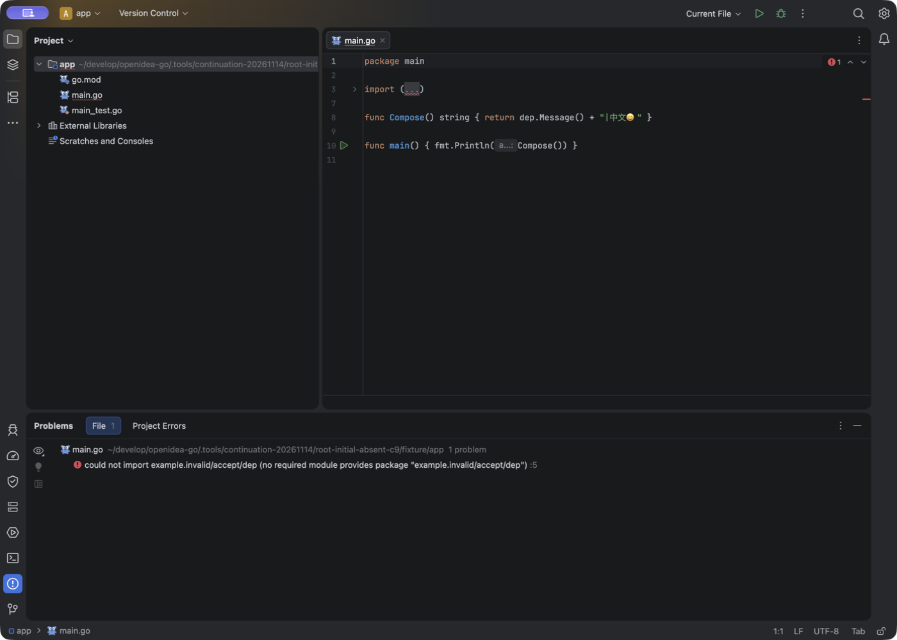

# 首次打开时缺失的本地依赖：C9 原生失败记录

**已确认的失败是：工程首次打开时，本地 replace 指向的目录还不存在；后来创建目录，编辑器仍停在旧的导入错误。** 这是固定源码 `643480a3d9d01c526210bdeba16df8431c1f4d75` 的独立本机 macOS 观察，版本字符串为 `0.1.0-preview.20261114.3`。它与[同一 C9 已存在根删除、重建后恢复成功](external-root-recovery-20261114.zh-CN.md#candidate9默认-bundled-gopls-的本机原生通过)是两个前提不同的场景，不能互相覆盖。

本次复用已经封存的 C9 App：590 个输入摘要 `895ae89d…08644`、981 项／175 报告零失败、错误和跳过，manifest `8e5bb04a…538e7`；来源见[完整构建核对](external-root-recovery-20261114-candidate9/independent-verification.json)。没有为此探针重新构建或执行测试。新 profile 以本项目 C9 配置为种子，system/plugins/log 为新目录，使用默认内置 gopls，没有 trace wrapper；不声称是干净默认配置。

## 实际发生了什么

工程的 `go.mod` 要求 `example.invalid/accept/dep v0.0.0`，并以 `replace` 指向 `../dep`。调用方一直调用 `dep.Message()`。App PID `6975`、窗口 `9927`，gopls PID `7005` / `7006` 在观察期间保持不变；仅打开调用方编辑器，没有打开外部源码，没有改调用方、手动 Reload 或重启服务。

| 阶段 | 独立 Go CLI 控制 | 原生编辑器实际结果 |
| --- | --- | --- |
| [首次打开，外部目录不存在](initial-absent-dependency-20261114-evidence/baseline.png) | exit 1：`replacement directory ../dep does not exist` | 第 5 行无法导入依赖，符合缺根状态 |
| [原路径原子放入 Greeting 目录](initial-absent-dependency-20261114-evidence/created-greeting.png) | 新根 inode `90698594`；exit 1：`undefined: dep.Message` | 等待约两分钟仍是旧的无法导入依赖，未更新为实际的未定义符号错误 |
| [只把外部源码恢复为 Message](initial-absent-dependency-20261114-evidence/restored-message.png) | 根 inode 不变；exit 0，输出 `依赖-v1\|中文😀` | 仍是旧导入错误，没有自动清除 |

[操作选取记录](initial-absent-dependency-20261114-evidence/operations.selected.normalized.json)保留三个原始回执的大小/SHA，以及实际 CLI 命令和输出。表内 CLI 结果不是原生 Run/Test。本轮没有执行原生 Run/Test，也没有重开工程或 Reload 对照，因此**没有经过验证的绕过办法**。“约两分钟”描述本轮等待观察，不是精确的诊断超时阈值。

## 收尾与证据边界

[收尾记录](initial-absent-dependency-20261114-evidence/postquit.selected.normalized.json)确认正常退出，四个已采样自有 PID 均消失；调用方三个源文件 SHA 未变，外部目录恢复为原本缺失的状态。创建出的目录移到 ignored 的 `retained-created-dep`，保留最后 Message 阶段的原字节与 inode。App 关键载荷未变，codesign 深度严格检查 exit 0，所核对的完整日志为 83,356 字节、SHA `fad9fb47…c552c`，没有 ERROR/SEVERE；完整日志和 profile 配置不公开。

三张 PNG 保持 REA 原字节，均关闭 AX 捕获；公开 JSON 明确是规范化选取或摘要，不冒充完整原始回执。[清单](initial-absent-dependency-20261114-evidence/manifest.json)逐文件给出大小、SHA 与原始来源；[失败摘要](initial-absent-dependency-20261114-evidence/native-failure-summary.json)保留功能失败和未验证范围。[公开夹具](initial-absent-dependency-20261114-evidence/fixture/README.zh-CN.md)包含三个调用方原文件和最终 Message 阶段的依赖源码。Greeting 原文件后来已被覆盖，只有原操作中的 SHA，不声称原文件仍存在，也不把 Message 源码改标为 Greeting 证据。

本轮没有保存实际 LSP 消息或 `go list` 原始元数据，**尚不能据此确定生产根因**。源码审查只能提出下一步控制向量，不能代替原生证据。该失败不推翻此前已存在根的恢复结果，也不证明 Windows 行为、完整模块语义或生命周期验收。PROJECT-02、LANG-04、ROBUST-01 仅追加局部失败引用，36 条 reference_runtime 与 36 条 reconstruction 仍全部为 unverified；发布状态另看正式交付证明。
